# 868 MHz LoRaWAN ISAC Surface-Permittivity Sensor Node (`Rev E.5`)

[](LICENSE)
[-0A66C2?style=flat-square)](#motivation--project-status)
[](#10-manufacturing-package-build--bench-bring-up)
[-2E7D32?style=flat-square)](#6-rak3172lp-sip-u1-lga-73-pin-map)
[](#2-operating-principle--rf-front-end)
[](#5-bare-metal-firmware--lorawan-103-stack)

An open-hardware Integrated Sensing and Communications (ISAC) sensor node operating in the European `863–870 MHz` (`EU868`) band. Rather than pairing a dedicated microwave sensor with a separate telemetry radio, the board uses a single Inverted-F + Interdigital Evanescent-Field Antenna (`AE1`) and a single `STM32WLE5JC` / `SX1262` System-in-Package (`RAK3172LP-SIP-8-SM-NI`) to measure surface permittivity through a `0.80 mm` radome and transmit Class A LoRaWAN telemetry over the same physical aperture.

| Front-Left Ray-Traced PCBA (`90 × 40 mm`) | Rear-Right RF Bridge & Sensing Aperture (`AE1`) |
| :---: | :---: |
| 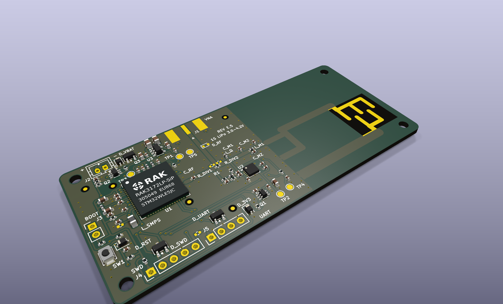 |  |

---

## Motivation & Project Status

Detecting glaze ice, standing water films, or hydrocarbon spills on remote infrastructure—roads, bridges, wind-turbine blades, and outdoor utility enclosures—usually forces an uncomfortable trade-off. Optical and ultrasonic sensors struggle with dirt, condensation, or heater power budgets, while dedicated 24/60/77 GHz radar modules add significant BOM cost and milliwatt-hour sleep/active overhead next to a LPWAN backhaul radio. At `868 MHz`, the near-field reactive zone of a compact PCB antenna already responds strongly to dielectric loading across a thin polymer radome. By inserting a low-loss (`-0.80 dB`) return-loss bridge between the `SX1262` transceiver and an interdigital-tip Inverted-F antenna, the radio can sweep three brief `+4.0 dBm` CW tones across the EU868 band to read the antenna's reflection signature before sending the result over LoRaWAN.

**Current Hardware Status (`Rev E.5`):**
- **Design & Turnkey Release:** Complete. Schematic, 2-layer PCB layout, full-wave 3D-FDTD / 2D-FVM electromagnetic models, freestanding C11 firmware, and the single-sided SMT fabrication package (`fab/ISAC_868_RevE5_PCBWay_Turnkey.zip`) are frozen at `Rev E.5`.
- **Pilot Build & Bench Validation:** The initial `5–10` board `Rev E.5` pilot lot is currently in turnkey fabrication. All impedance, directivity, sensitivity, and sleep-current figures in this repository are simulation- and datasheet-derived predictions awaiting physical VNA, power-analyzer, and environmental chamber correlation on the pilot boards. Open bench measurements are tracked in [`docs/OPEN_ITEMS.md`](docs/OPEN_ITEMS.md) and [`docs/bringup_report.md`](docs/bringup_report.md).
- **Note on Parametric KiCad Workflow:** Alongside the standard KiCad 9.0.8 project files (`ISAC_868_KiCad9.kicad_sch` and `ISAC_868_KiCad9.kicad_pcb`), [`tools/`](tools/) contains the Python CAD scripts (`gen_sch.py`, `gen_pcb.py`) used to synthesize the RF layout. Keeping the copper coordinates parametric ensures the CPWG line widths, `/BR_S` ground-plane relief, and interdigital finger geometry in KiCad match the meshes fed into the 2D-FVM and 3D-FDTD solvers without manual transcription drift.

---

## Table of Contents

1. [Architecture Overview & Specifications](#1-architecture-overview--specifications)
2. [Operating Principle & RF Front-End](#2-operating-principle--rf-front-end)
3. [Power Tree, ESD Protection & Test Points](#3-power-tree-esd-protection--test-points)
4. [Electromagnetic Simulation & Tolerance Analysis](#4-electromagnetic-simulation--tolerance-analysis)
5. [Bare-Metal Firmware & LoRaWAN 1.0.3 Stack](#5-bare-metal-firmware--lorawan-103-stack)
6. [`RAK3172LP-SiP` (`U1`, `LGA-73`) Pin Map](#6-rak3172lp-sip-u1-lga-73-pin-map)
7. [3-Tone Dielectric Benchmarks & `FPort = 10` Payload](#7-3-tone-dielectric-benchmarks--fport--10-payload)
8. [Self-Draining `ASA/PETG` Mechanical Enclosure](#8-self-draining-asapetg-mechanical-enclosure)
9. [Engineering Trade-Offs & `Rev F.0` Roadmap](#9-engineering-trade-offs--rev-f0-roadmap)
10. [Complete `Rev E.5` Turnkey Bill of Materials](#10-complete-rev-e5-turnkey-bill-of-materials)
11. [Manufacturing Package, Build & Bench Bring-Up](#11-manufacturing-package-build--bench-bring-up)
12. [Repository Structure](#12-repository-structure)
13. [Author, Citation & License](#13-author-citation--license)

---

## 1. Architecture Overview & Specifications

- **Shared-Aperture 868 MHz Sensing & Telemetry:** Reuses the `SX1262` `RFO_LP` synthesizer for `+4.0 dBm` 3-tone CW reflectometry (`863.1`, `866.5`, `869.5 MHz`; `< 1.25 ms` dwell per tone) and `+14.0 dBm` LoRaWAN Class A uplinks. Full-wave 3D-FDTD modeling predicts `43.73 MHz/RIU` Air-to-Ice resonant frequency sensitivity and `17.60 dB` (`P01` 1st-percentile Monte-Carlo floor) 2-point calibrated Air-to-Ice contrast.
- **Differential Reflectometry & Ratiometric ADC Scaling:** Samples coupled reflection power through an Analog Devices `LT5538IDD#TRPBF` (`40 MHz – 3.8 GHz`, `19.0 mV/dB`) logarithmic detector to compute log-power slope (`Tilt`), in-band resonance depth (`Notch`), and calibrated mean reflection (`Level`). Common-mode PA power variations and detector log-intercept drift cancel in `Tilt` and `Notch`, while per-tone `VREFINT` (`ADC_IN13`) scaling removes supply-voltage sensitivity across `3.00–3.30 V`.
- **Ambient Ingress Blanking & Harmonic Filtering:** Firmware performs a TX-off Listen-Before-Sense (`LBS`) check (`≤ 320 mV` / `~ -72 dBm` threshold with `PA8`-gated backoff retries and a post-sweep discharge check) and ramps CW power down to `-9 dBm` (`40 µs`) before `STDBY_XOSC`. On the PCB, a 3rd-order elliptic low-pass Pi-filter suppresses harmonic emissions (`2f0 ≥ 37.2 dB`, `3f0 ≥ 60.1 dB`).
- **Dielectric-Aware Data-Rate Adaptation:** When ice or water detunes the antenna (`f0: 869.0 MHz → 776.0 MHz`), firmware steps LoRaWAN uplinks from `SF7BW125` (`DR5`) to `SF9` (`DR3` for glaze ice) or `SF12BW125` (`DR0`, `+12.5 dB` processing gain), preserving a `136.6–139.6 dB` maximum coupling loss (MCL) link budget within rolling 1-hour ETSI `EN 300 220-1` duty-cycle limits (`≤ 0.1%` on `863.1 MHz` Sub-band `g1`, `≤ 1.0%` on EU868).
- **Split-Rail Low-Power Supply:** Routing the pulsed `28 mA` RF detector supply (`Q1 = TPS22919DCKR`) directly from `VBAT` keeps the always-on `3.3 V` nanopower LDO (`U3 = TPS7A0233DBVR`, `I_Q = 25 nA`) lightly loaded (`24.1 mA` peak, `36.2 mV` dropout), preserving `3.0 V` `DIO3` TCXO regulation down to `3.00 V` battery cutoff with an estimated `2.85–3.25 µA` `STOP2` sleep current.
- **Single-Sided SMT Layout:** `92` footprints total (`67` populated top-side SMD parts, `10` `DNP`, `15` `BOARD_ONLY`; `0` THT parts in automated assembly, `131` tented `0.60/0.30 mm` vias, `0` via-in-pad), housed in a flat-roof (`+8.50 mm`), open-East self-draining `0.80 mm` `ASA/PETG` O-ring enclosure.

| Parameter | `Rev E.5` Design Specification | Verification Script / Reference |
| :--- | :--- | :--- |
| **Hardware Revision & DRC Rules** | `Rev E.5` (`Hardware Revision E.5`, rule hash `ff1d145fc6dc1ce6...`, `57/57` KiCad 9 DRC rules set to `error`) | `tools/rules_isac.py --verify` |
| **PCB Dimensions & Stackup** | `90.00 × 40.00 × 1.60 mm` (`+0.03/-0.10 mm` finished `1.50–1.63 mm`, `R = 2.00 mm` corners), 2-layer `1 oz` (`35 µm`) `FR-4` ($\varepsilon_r = 4.4 \pm 0.2$, `1.51 mm` core) | `tools/check_dfm.py` |
| **Surface Finish, Mask & Stencil** | IPC-4552 `ENIG` (`1–3 µin Au` over `120–240 µin Ni`); Green LPI (`0.035 mm` global / `0.025 mm` `U1,U2` NSMD / `0.00 mm` `AE1` bare-`ENIG` window, `≥ 0.180 mm` dams, tented vias); `0.10 mm` (`100 µm`) electropolished top SS stencil (`B_Paste.gbp` omitted) | `ISAC_868_KiCad9-job.gbrjob` & `tools/check_dfm.py` |
| **Manufacturing Origin (`AuxOrigin`)** | `(103.500, 120.000) mm` = bottom-left PCB corner (`X_gbr: 0..90 mm`, `Y_gbr: 0..40 mm`) across Gerbers, Drills, CPL & STEP | `tools/check_bom_cpl.py` |
| **Footprint & Via Count** | `92` footprints = `67` populated SMD (`0` THT) + `10` DNP (`C_SMPS3, D_RF, J1..J5, R_DIV1, R_DIV2, R_VUART`) + `15` `BOARD_ONLY` (`AE1, FID1..5, H1..4, TP1..5`); `131` tented vias | `tools/verify_design_consistency.py` |
| **Wireless MCU SiP & SMPS (`U1`)** | `RAK3172LP-SIP-8-SM-NI` (`STM32WLE5JC` Cortex-M4 + `SX1262` `RFO_LP`, `3.0 V` `DIO3` TCXO `0x06`, internal SPDT `PA0/PA1`) + `15 µH` wirewound `L_SMPS` (`LQH2MCN150K02L`, `Isat = 300 mA`) + `C_SMPS1 = 4.7 µF`, `C_SMPS2 = 470 nF` | `docs/reports/u1_footprint_verification.md` & `docs/SOURCES.md` |
| **CPWG `50 Ω` Spine** | `F.Cu` `W = 1.08 mm`, gap `S = 0.28 mm` over continuous `B.Cu` $\rightarrow$ `Z0 = 51.90 Ω` (`51.2–57.1 Ω` tolerance envelope, `RL ≥ 26.8 dB`, max segment `11.18 mm = 0.056 λ_g`) | `rf/cpwg_2dfvm_solver.py` |
| **Return-Loss Bridge & Detector (`U2`)** | Asymmetric resistive-reactive bridge (`R1 = 8.2 Ω` `RT0402BRD078R2L` `0.1%`, `R2 = 681 Ω`, `R3 = 3.57 kΩ`, `R_TERM = 56 Ω` `0.1%`, `L_Q = 27 nH`, `L_S = 30 nH`, `C_S = C_S2 = 1.0 pF`) over `2.20 × 2.20 mm` `F.Cu/B.Cu` relief ($C_{\text{par}} = 0.1305\text{ pF}$) $\rightarrow$ `IL = -0.802 dB`, `50 Ω` directivity = `24.81 dB`, feeding `LT5538IDD#TRPBF` | `rf/bridge_sparam_mc.py` & `rf/bridge_loss.py` |
| **Elliptic Harmonic Filter & `AE1`** | `C_M1 = 3.6 pF` (`GJM1555C1H3R6WB01D`), `L_M1 = 8.2 nH` (`LQW15AN8N2G00D`) `|| C_MZ = 0.5 pF` (`GJM1555C1HR50WB01D`), `C_M2 = 4.3 pF` (`GJM1555C1H4R3WB01D`) (`2f0 ≥ 37.2 dB`, `3f0 ≥ 60.1 dB` rejection) + `AE1` bonded via `25 µm` `3M 467MP` to `0.80 mm` `ASA/PETG` window (`f0 = 869.0 MHz`, `|S11| = -20.83 dB`, `η_tot = 45.5%`, `43.73 MHz/RIU`, `17.60 dB` `P01` ice contrast) | `rf/ifa_enclosure_mom.py` |
| **Power Supply & Sleep Budget** | 1S Li-ion/LiPo or `3.6 V` `Li-SOCl2` (`3.00–4.20 V`, `4.35 V DC MAX` on `J2 = DNP` bottom solder pads) $\rightarrow$ `AO3401A` (`Q3`, `< 6 mV` drop) $\rightarrow$ `TPS7A0233DBVR` (`U3`, `3.3 V`), `TPS22919DCKR` (`Q1`, `PA8` `3.0 ms` `VBAT` switch), `NX3008CBKS,115` (`Q2`, `PA9` `150 µs` battery sense) | `docs/power_budget.md` |

---

## 2. Operating Principle & RF Front-End

### 2.1 Signal Chain

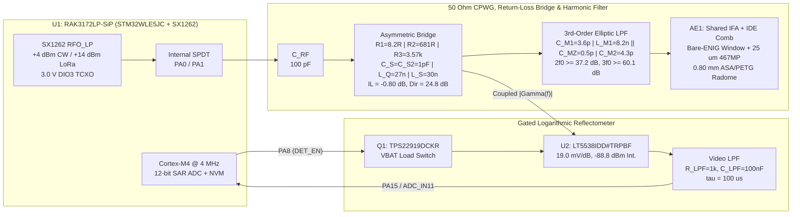

### 2.2 Electromagnetic Sensing Mechanism
1. **Evanescent Fringing-Field Coupling (`AE1`):** The capacitive open end of the `868 MHz` Inverted-F Antenna (`IFA_868MHz_ISAC_40x20mm`) terminates in an interdigital electrode (`IDE`) comb (`1.30 mm` fingers, `1.20 mm` gaps, `~0.80 mm` `1/e` evanescent decay length). The comb is left free of solder mask as a bare-`ENIG` window (`X_gbr = [73.40..87.80], Y_gbr = [6.65..20.80] mm`) and laminated flush against the `0.80 mm` `ASA/PETG` lid window with `25 µm` `3M 467MP` transfer tape so an air pocket cannot mask exterior permittivity changes.
2. **Permittivity-Driven Detuning:** In unloaded Dry Air ($\varepsilon_r' = 1.00$), the enclosed antenna and elliptic filter resonate at `869.0 MHz` (`|S11| = -20.83 dB` at `866.5 MHz`), placing a sharp return-loss null inside the EU868 band. When oil ($\varepsilon_r' \approx 2.1$), glaze ice ($\varepsilon_r' \approx 3.20$), polar fluid ($\varepsilon_r^* = 6.29 - j6.09$), or liquid water ($\varepsilon_r^* = 79.9 - j3.81$) covers the outer window, the superstrate permittivity pulls $f_0$ down (`849.0 → 776.0 MHz`) and alters both the magnitude and slope of $|\Gamma(f)|$ across the three CW probe frequencies:
   - $f_1 = 863.100\text{ MHz}$ (EU868 lower band edge, `ERC/REC 70-03` Sub-band `g1`)
   - $f_2 = 866.500\text{ MHz}$ (in-band resonance probe)
   - $f_3 = 869.500\text{ MHz}$ (EU868 upper `g3` sub-band)
3. **Low-Loss Asymmetric Bridge & Unpowered TX Linearity:** A symmetric Wheatstone bridge would cost `6.0 dB` round-trip in LoRaWAN link margin. Instead, an inline `R1 = 8.2 Ω` (`0.1%` thin-film) series sensor paired with `1.0 pF` capacitive taps (`C_S, C_S2`) holds main-path insertion loss to `-0.802 dB` while providing `24.81 dB` nominal `50 Ω` directivity over a `2.20 × 2.20 mm` dual-layer ground relief ($C_{\text{par}} = 0.1305\text{ pF} < 0.15\text{ pF}$). During `+14 dBm` LoRaWAN uplinks (`U2` unpowered via `PA8 = 0`), capacitive voltage division limits `U2` Pin 2 (`IN+`) swing to `39.5 mV_pk` even into a `6:1` water VSWR—well below the `~350 mV` ESD diode conduction knee—preventing passive harmonic generation on the transmit path.

---

## 3. Power Tree, ESD Protection & Test Points

| Top Ray-Traced PCBA View (`F.Cu` — `67` SMD Parts) | Bottom Ray-Traced PCBA View (`B.Cu` Continuous Ground Plane) |
| :---: | :---: |
| 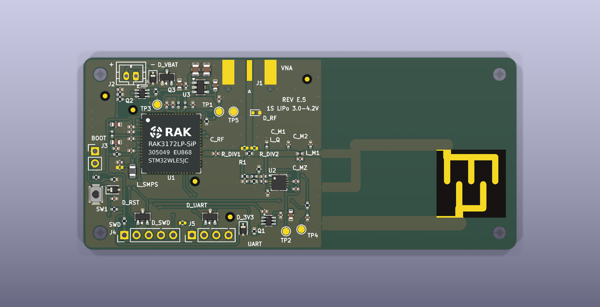 | 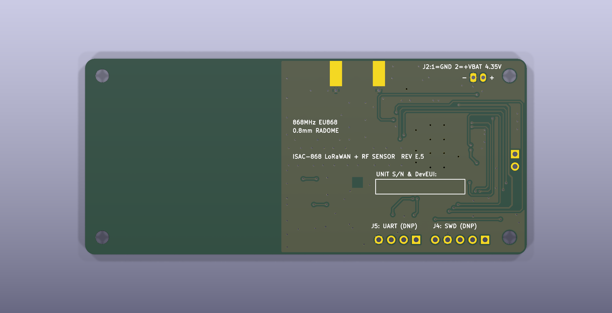 |

### 3.1 Split-Rail Power Topology
- **Reverse-Polarity Protection (`Q3 = AO3401A`):** P-MOSFET ideal diode limits forward drop to `< 6 mV` during TX bursts, decoupled by `2 × 47 µF` (`C_BULK1, C_BULK2`) and `10 µF` (`C_IN1`) MLCCs.
- **Direct `VBAT` Detector Gating (`Q1 = TPS22919DCKR` on `PA8`):** `LT5538IDD#TRPBF` (`V_CC = 3.0–5.25 V`, `I_CC ≈ 28 mA`) runs directly from `VBAT` through slew-rate-controlled load switch `Q1` (`t_ON ≤ 1.6 ms`, firmware settle wait `3.0 ms`, `250 Ω` active output discharge when disabled). Keeping `U2`'s `28 mA` pulse off `U3` restricts peak `3V3` LDO current to `24.1 mA` (`36.2 mV` dropout, `8.30×` margin below `U3`'s `200 mA` rating), so `RAK3172LP-SiP`'s internal `3.0 V` `DIO3` TCXO rail (`0x06`) stays in regulation down to `3.00 V` cell end-of-life at `-20 °C`.
- **Switched Battery Divider (`Q2 = NX3008CBKS,115` on `PA9`):** Dual N/P TrenchMOS high-side switch enables the `4.7 kΩ / 4.7 kΩ` (`0.1%`) divider (`PB4 / ADC_IN3`) for `150 µs` once per cycle, eliminating continuous divider bleed in `STOP2`.
- **Pogo-Fixture Isolation & ESD Clamping:** `J4.1` (`SWD` target sense via `R_VAPP = 1.0 kΩ`), `J5.1` (`UART` isolated via `R_VUART = DNP`), `J3.2` (`BOOT0` via `R_BHI = 10 kΩ`), and bidirectional TVS diodes (`D_VBAT, D_3V3, D_RST = PESD5V0S1BA,115`; `D_SWD, D_UART = PESD5V0U2BT,215`) provide IEC 61000-4-2 Level 4 ESD protection and prevent bench debug probes from back-feeding rechargeable LiPo or primary `Li-SOCl2` cells.

### 3.2 DC Test-Point Map (`TP1..TP5`)
All test points sit on DC or baseband nodes so probe pads never load the `868 MHz` bridge or CPWG spine:

| Test Point | Schematic Net | Gerber `(X_gbr, Y_gbr)` [mm] | Bring-Up / Fixture Measurement Role |
| :---: | :--- | :---: | :--- |
| **`TP1`** | `3V3` | `(28.200, 28.750)` | Regulated `3.30 V` always-on LDO output (`U3.5`) |
| **`TP2`** | `3V3_DET` | `(42.100, 3.800)` | `VBAT`-switched `U2` (`LT5538IDD#TRPBF`) supply rail (`Q1.6`, verify `3.0 ms` rise) |
| **`TP3`** | `VBAT` | `(15.350, 30.200)` | Post-`Q3` (`AO3401A`) reverse-protected `1S` battery rail |
| **`TP4`** | `/DET_ADC` | `(45.300, 4.200)` | Filtered `LT5538` analog log-detector voltage (`PA15 / ADC_IN11`, `4.04 mm` clear of `L_SMPS`) |
| **`TP5`** | `GND` | `(31.200, 28.750)` | Low-inductance DMM / oscilloscope ground reference |

---

## 4. Electromagnetic Simulation & Tolerance Analysis

All RF synthesis and verification solvers live in [`rf/`](rf/) and run locally with open-source Python/C99 toolchains:

1. **Graded 2D Finite-Volume (`2D-FVM`) CPWG Solver (`rf/cpwg_2dfvm_solver.py`):** Solves $\nabla \cdot (\varepsilon_r(x,y)\nabla V) = 0$ across the `1.51 mm` FR-4 core, `35 µm` copper thickness, and Green LPI solder mask (`Z0 = 51.90 Ω` nominal, cross-checked against analytical conformal mapping).
2. **3D Non-Uniform Yee-Grid Maxwell FDTD Solver (`rf/fdtd_3d_ant.c` + `rf/ifa_enclosure_mom.py`):** C99/OpenMP 3D FDTD solver importing the exact KiCad `IFA_868MHz_ISAC_40x20mm.kicad_mod` copper polygon, `50 × 40 mm` ground plane, IPC-4552 `ENIG` (`NiP/Au`) surface resistance ($R_s = 23.74\text{ m}\Omega/\square$), `3M 467MP` adhesive layer, `0.80 mm` `ASA/PETG` radome, battery pouch, and `2.0 mm` Debye superstrates, cascaded with the 3rd-order elliptic harmonic Pi-filter.
3. **2,000-Trial Bridge Monte-Carlo (`rf/bridge_sparam_mc.py`):** Sweeps `3σ` component tolerances (`0.1%` thin-film resistors, `±0.05 pF` `GJM` C0G capacitors, `±2%` `LQW15AN` wirewound inductors, and ADI `LT5538` Table 1 `291.65 Ω || 1.194 pF` input impedance), predicting `99.72%` Water-vs-IPA separation yield (`P01` margin `0.65 dB ≥ 0.50 dB`) after 2-point calibration.

| Full-Wave 3D FDTD `S11` & Elliptic Filter (`ifa_enclosure_mom.png`) | 2,000-Trial Bridge Monte-Carlo (`bridge_sparam_mc.png`) |
| :---: | :---: |
| 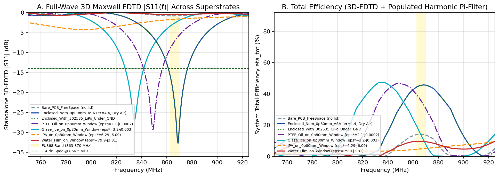 | 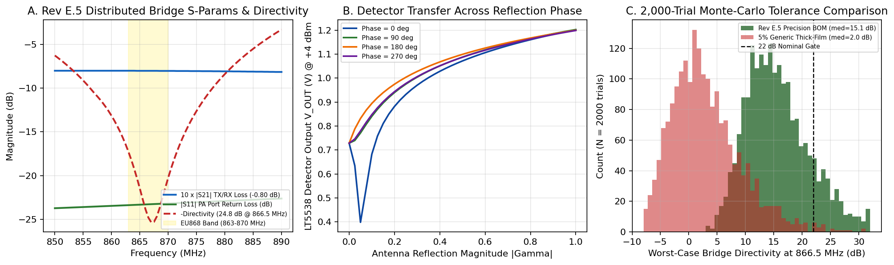 |

| 2D-FVM `51.90 Ω` CPWG Cross-Section (`cpwg_2dfvm_cross_section.png`) | `U1` `RAK3172LP-SiP` `LGA-73` Pad Overlay (`0.0000 mm` Error) |
| :---: | :---: |
| 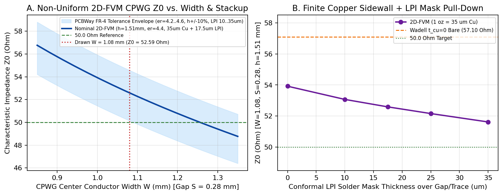 | 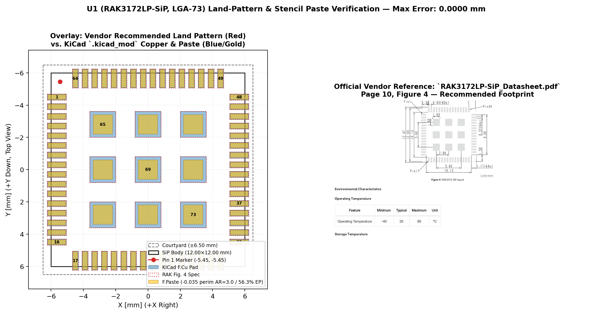 |

---

## 5. Bare-Metal Firmware & LoRaWAN 1.0.3 Stack

The target firmware ([`firmware/`](firmware/)) is written in freestanding ISO C11 (`-Wall -Wextra -Werror -Wstack-usage=2048 -ffreestanding -nostdlib`), compiling into `15,948 B` Flash and `408 B` RAM on `STM32WLE5JC` without vendor HAL dependencies.

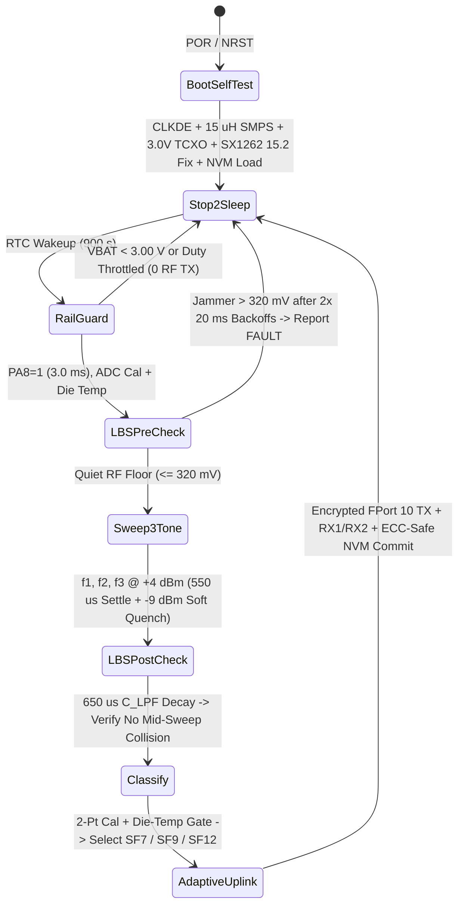

### Firmware Design Notes
- **Silicon Errata & Radio Initialization (`isac_sensing.c`, `isac_lorawan_eu868.c`):** Enables `SUBGHZ_SMPSC0R.CLKDE` (`0x0916 |= 0x40`) with readback verification prior to setting `PWR_CR5.SMPSEN` (`DS13105 §3.9.1`; falls back to `USE_LDO` on mismatch), configures `SetDIO3AsTCXOCtrl(0x06, 3.0 V)`, applies `SX1262 §15.2` `TxClampConfig` (`0x08D8 |= 0x1E`) PA clamp protection for high-VSWR loads, and sets `0x0889` (`BW125` modulation quality) and `0x0736` (IQ polarity) workarounds.
- **Listen-Before-Sense (`LBS`) & Soft-Ramp CW Quench (`isac_sensing.c`):** Reads `LT5538` with `CW = OFF` before each sweep (`2 × 20 ms` `PA8 = 0` backoff retries if ambient ingress exceeds `320 mV`) and again after the sweep (`650 µs` = `6.5 τ_LPF` discharge) so co-channel LoRa/LTE packets flag `ISAC_SURFACE_FAULT` rather than corrupting a dielectric reading. Each CW tone ramps down to `-9 dBm` (`40 µs` ramp + `50 µs` hold) before returning to `STDBY_XOSC`.
- **Temperature-Gated Ice Disambiguation:** Cross-checks 2-point calibrated `(Level, Tilt, Notch)` features against `ADC_IN12` internal die temperature (`ISAC_ICE_MAX_TEMP_DEGC_X10 = +4.0 °C`) so thin warm water films above `+4 °C` do not misclassify as `GLAZE_ICE`.
- **LoRaWAN 1.0.3 EU868 MAC, Crypto & Flash NVM (`isac_lorawan_eu868.c`, `isac_nvm.c`):** Constant-time FIPS-197 AES-128 and RFC 4493 CMAC, OTAA Join with `CFList` parsing, `RX1 (+1.0 s)` / `RX2 (+2.0 s, 869.525 MHz SF12)` windows with `SetStopRxTimerOnPreamble(1)`, `RXParamSetupReq (0x05)` handling, `§7` 3-tier 96-hour Join backoff (`< 8.2 s / 24 h` in Tier 3), `2^32 ms` wrap-safe ETSI `0.1%` + `1.0%` duty-cycle accounting, and dual-page (`0x0803E800 / 0x0803F000`) CRC-32 NVM with Flash `ECCD` `NMI` recovery.

---

## 6. `RAK3172LP-SiP` (`U1`, `LGA-73`) Pin Map

Cross-checked automatically by `tools/check_bom_cpl.py` and `tools/verify_u1_overlay.py` (`0.0000 mm` pad coordinate delta; see [`docs/reports/u1_footprint_verification.md`](docs/reports/u1_footprint_verification.md)) against `fab/netlist/ISAC_868_KiCad9.net` and `firmware/include/isac_board_pins.h`:

| `U1` Pin(s) | SiP / STM32WLE5JC Function | Schematic Net | Firmware Macro / ADC Channel | Connected Subsystem |
| :---: | :--- | :--- | :--- | :--- |
| **`1`** | `PA13 / JTMS-SWDIO` | `/SWDIO` | `ISAC_SIP_PIN_SWDIO` (`PA13`) | `J4.2` (`DNP` pogo pad) via `D_SWD` (`PESD5V0U2BT,215`); `J4.1` isolated via `R_VAPP = 1 kΩ` + `D_3V3` |
| **`2`** | `PA14 / JTCK-SWCLK` | `/SWCLK` | `ISAC_SIP_PIN_SWCLK` (`PA14`) | `J4.3` (`DNP` pogo pad) via `D_SWD` (`PESD5V0U2BT,215`) |
| **`3, 4, 55`** | `VDD1 / VBAT / VDD2` | `3V3` | `ISAC_SIP_PIN_VDD1 / VBAT_MCU / VDD2` | Always-on `U3` (`TPS7A0233DBVR`, `24.1 mA` peak) + `C_U1A..C` + `D_3V3` |
| *(Internal SiP)* | `PA0 / PA1` (`VC1 / VC2`) + `PB0` (`DIO3`) | *(Internal SiP substrate)* | `ISAC_GPIOA_PIN_RFSW_VC1 / VC2` + `SetDIO3AsTCXOCtrl(0x06, 3.0 V)` | Internal SPDT: `IDLE=(0,0)`, `RX=(1,0)`, `TX=(0,1)`; `3.0 V` `32 MHz` TCXO (`0x06`) + `32.768 kHz` LSE (`LSERDY` fallback to `LSI`) |
| **`6, 7`** | `VREF+ / VDDA` | `/VDDA` | `ISAC_SIP_PIN_VREF_PLUS / VDDA` (`ADC_IN13` `VREFINT`, `ADC_IN12` `TSEN`) | `FB_VDDA` (`BLM15AG121SN1D`) + `C_VDDA1, C_VDDA2, C_VREF` |
| **`8`** | `PA15 / ADC_IN11` | `/DET_ADC` | `ISAC_GPIOA_PIN_DET_ADC` (`15U`), `ADC_IN11` (`SMP1=12.5 cyc`) | Switched from `JTDI` pull-up to analog in `Reset_Handler`; `U2` (`LT5538IDD#TRPBF`) output via `R_LPF=1 kΩ`, `C_LPF=100 nF`, `TP4` |
| **`10, 11, 13`** | `VFBSMPS / VDDSMPS / VLXSMPS` | `/VFBSMPS`, `/VDDSMPS`, `/VLXSMPS` | `ISAC_PWR_CR5_SMPSEN` (`0x5800041C`) + `CLKDE` (`0x0916`) | `15 µH` wirewound `L_SMPS` (`LQH2MCN150K02L`, `Isat = 300 mA`) + `FB_SMPS=0 Ω`, `C_SMPS1=4.7 µF`, `C_SMPS2=470 nF` (`C_SMPS3=DNP`) |
| **`15`** | `PB4 / ADC_IN3` | `/BAT_SENSE` | `ISAC_GPIOB_PIN_BAT_SENSE` (`4U`), `ADC_IN3` | Switched from `NJTRST` pull-up to analog in `Reset_Handler`; `Q2`-gated `R_B1=R_B2=4.7 kΩ (0.1%)` + `C_BAT=1 nF` (`150 µs` pulse) |
| **`29, 30`** | `PA2 / USART2_TX`, `PA3 / USART2_RX` | `/UART_TX`, `/UART_RX` | `ISAC_GPIOA_PIN_UART2_TX / RX` (`Analog High-Z` when `ISAC_DEBUG_UART=0`) | `J5.2 / J5.3` (`DNP` pogo pads) via `D_UART` (`PESD5V0U2BT,215`); `J5.1` isolated by `R_VUART = DNP` |
| **`37`** | `RF_OUT` (`50 Ω` `RFO_LP` / `RFI`) | `/RF_PA` | `ISAC_SIP_PIN_RF_OUT` (`+4 dBm` CW / `+14 dBm` LoRa) | `C_RF` (`100 pF`) $\rightarrow$ CPWG $\rightarrow$ Bridge $\rightarrow$ Elliptic Pi-Filter (`C_M1=3.6p, L_M1=8.2n||C_MZ=0.5p, C_M2=4.3p`) $\rightarrow$ `AE1` |
| **`43`** | `PH3 / BOOT0` | `/BOOT0` | `ISAC_SIP_PIN_BOOT0` | `10 kΩ` `R_BOOT` pulldown + `J3` (`DNP` pogo pads; `J3.2` current-limited via `R_BHI = 10 kΩ`) |
| **`44`** | `NRST` | `/RST` | `ISAC_SIP_PIN_NRST` | `J4.5` (`connect-under-reset` SWD pogo) + `10 kΩ` `R_RST` + `100 nF` `C_RST` + `SW1` + `D_RST` (`PESD5V0S1BA,115`) |
| **`50`** | `PA9` (`BAT_MON_EN`) | `/BAT_MON_EN` | `ISAC_SIP_PIN_BAT_MON_EN` (`PA9`, `9U`) | Dedicated battery divider gate: `Q2` (`NX3008CBKS,115` `VBAT_SW`, `R_BG = 470 kΩ`) + `100 kΩ` `R_BPD` |
| **`51`** | `PA8` (`DET_EN`) | `/DET_EN` | `ISAC_SIP_PIN_DET_EN` (`PA8`, `8U`) | Dedicated RF detector gate: `VBAT`-fed `Q1` (`TPS22919DCKR` + `C_Q1=100 nF` $\rightarrow$ `3V3_DET`) + `100 kΩ` `R_PD` |
| **`53, 54`** | `VDDPA / VDDRF` | `/VDDPA`, `/VDDRF` | `ISAC_SIP_PIN_VDDPA / VDDRF` | Dedicated ferrite beads `FB_PA`, `FB_RF` + `1 µF` `C_PAV`, `C_RFV` |
| **`65..73`** | Central `3 × 3` Thermal/RF `GND` | `GND` | Solid `B.Cu` plane (`56.3%` `1.20×1.20 mm` windowed paste) | `4` interstitial tented `0.60/0.30 mm` vias (`0` via-in-pad) |

---

## 7. 3-Tone Dielectric Benchmarks & `FPort = 10` Payload

### 7.1 Simulated 3D-FDTD Benchmark Table
*(Conditions: `+4.0 dBm` CW sensing TX, ADI `LT5538IDD#TRPBF` `IN+` `291.65 Ω || 1.194 pF`, `0.80 mm` self-draining `ASA/PETG` window + `25 µm` `3M 467MP`, 2-point calibrated & `VREFINT`/`TSEN` compensated; nominal `3.30 V`, `25 °C` 12-bit ADC codes shown)*

| Medium | $\varepsilon_r^*$ (`868 MHz`) | $f_0$ [MHz] | $\eta_{\text{tot}}$ [%] | `ADC` (`863.1 / 866.5 / 869.5`) | `Tilt` [dB] | `Notch` [dB] | `Level` [dBm] | Adaptive LoRa `SF` | Classified State |
| :--- | :---: | :---: | :---: | :---: | :---: | :---: | :---: | :---: | :--- |
| **Dry Air** | `1.00 - j0.000` | `869.0` | `45.5%` | `1015 / 940 / 1096` | `-3.44` | `+4.88` | `-45.66` | `SF7` (`DR5`) | `0 = DRY_AIR` |
| **PTFE / Oil** | `2.10 - j0.0002` | `849.0` | `35.4%` | `1296 / 1307 / 1325` | `-1.23` | `+0.15` | `-33.26` | `SF7` (`DR5`) | `1 = OIL` |
| **Glaze Ice** | `3.20 - j0.003` | `834.5` | `13.4%` | `1419 / 1418 / 1419` | `-0.01` | `+0.06` | `-28.63` | `SF9` (`DR3`) | `2 = GLAZE_ICE` |
| **Alumina (`Al2O3`)** | `9.80 - j0.002` | `783.0` | `5.1%` | `1495 / 1476 / 1458` | `+1.56` | `+0.03` | `-26.19` | `SF12` (`DR0`) | `3 = IPA` (Cal Ref) |
| **IPA (`868 MHz`)** | `6.29 - j6.090` | `794.0` | `4.8%` | `1457 / 1439 / 1423` | `+1.45` | `+0.04` | `-27.75` | `SF12` (`DR0`) | `3 = IPA` |
| **Water Film** | `79.9 - j3.810` | `776.0` | `9.6%` | `1487 / 1472 / 1458` | `+1.22` | `+0.04` | `-26.35` | `SF12` (`DR0`) | `4 = LIQUID_WATER` |

### 7.2 10-Byte Big-Endian LoRaWAN `FPort = 10` Payload (`firmware/src/isac_sensing.c`)

| Byte(s) | Field Name | Type & Endianness | Resolution & Encoding |
| :---: | :--- | :---: | :--- |
| **`0`** | `state_flags` | `uint8` | `[7]=1 (RevE_Frame)`, `[6]=Duty_Throttled`, `[5]=Low_Battery (<3100 mV)`, `[4]=SMPS_DCDC_Active`, `[3:0]=SurfaceState` (`0=DRY_AIR`, `1=OIL`, `2=GLAZE_ICE`, `3=IPA`, `4=LIQUID_WATER`, `15=FAULT`) |
| **`1..2`** | `tilt_db_x100` | `int16 BE` | `0.01 dB` — `(V(f1) - V(f3)) / (19.0 mV/dB)` |
| **`3..4`** | `level_dbm_x100` | `int16 BE` | `0.01 dBm` — Mean coupled reflection power across `f1..f3` (die-temp compensated) |
| **`5..6`** | `eps_est_x100` | `uint16 BE` | `0.01 RIU` — Piecewise-monotonic estimated real permittivity $\hat{\varepsilon}_r' \times 100$ (`0` on `FAULT`) |
| **`7..8`** | `vbat_mv` | `uint16 BE` | `1 mV` — `PA9`-gated post-`Q3` battery voltage (`3000–4200 mV` nominal) |
| **`9`** | `notch_db_x10` | `int8` | `0.1 dB` clamped `[-128..+127]` — `((V(f1) + V(f3))/2 - V(f2)) / (19.0 mV/dB)` |

---

## 8. Self-Draining `ASA/PETG` Mechanical Enclosure

The parametric enclosure generator ([`enclosure/gen_enclosure.py`](enclosure/gen_enclosure.py)) builds watertight 2-manifold STL solids (`95.7 × 45.7 × 16.1 mm` outer envelope) checked with `trimesh`:
- **Flat Roof (`z_top = +8.50 mm`) & Open-East Window:** No connector slots penetrate the lid over the electronics bay (`J1..J5 = DNP`), and the thinned `0.80 ± 0.02 mm` sensing window opens flush onto the East edge (`0.00 mm` lip) so rain sheds freely rather than pooling over `AE1`.
- **Parker `ORD 5700` EPDM O-Ring Face Seal:** Continuous `360°` `1.80 × 0.76 mm` groove with `0.16 mm` skirt clearance (`0.92 mm` gland depth, `23.3%` squeeze, `68.3%` gland fill), clamped by `4 × M2.5 × 22 mm` corner screws positioned outside the dry seal perimeter.
- **Interchangeable Base Trays:** **Option A** (`ISAC_868_Base_Tray.stl` for a flat `302535` 1S LiPo pouch cell) and **Option B** (`ISAC_868_Base_Tray_Battery.stl` for a stepped `ER14335M` `2/3 AA` `3.6 V` primary `Li-SOCl2` cell), each with a recessed bottom wire channel to `J2`.

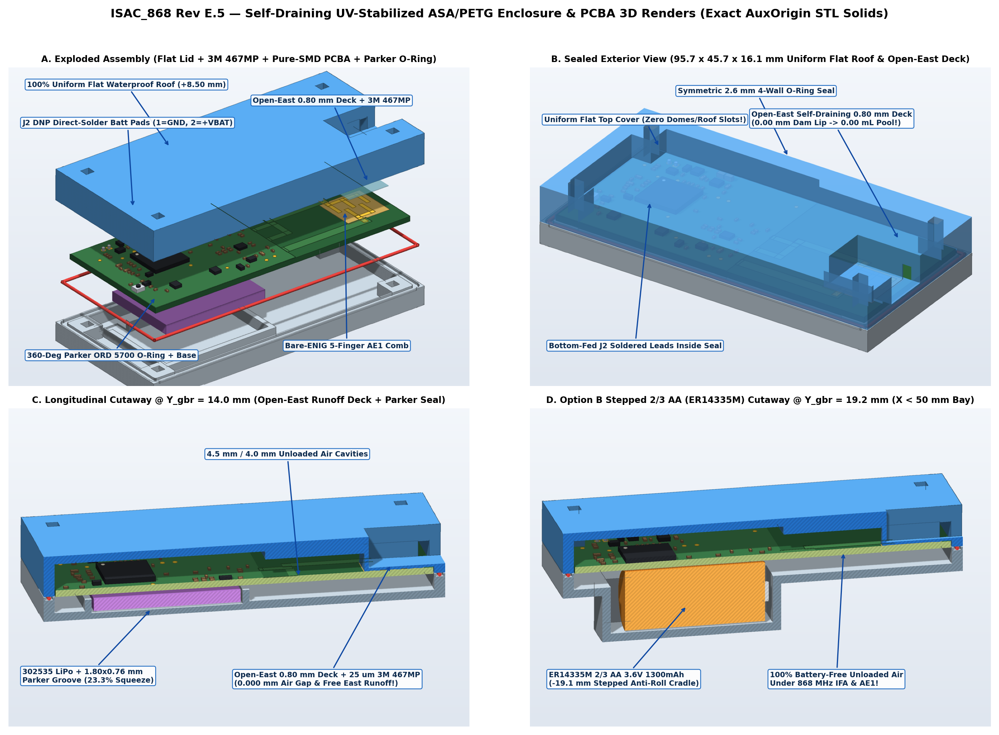

| Option A (`302535` Slim 1S LiPo Base Tray Blueprint) | Option B (`ER14335M` `2/3 AA` Stepped Battery Bay Blueprint) |
| :---: | :---: |
| 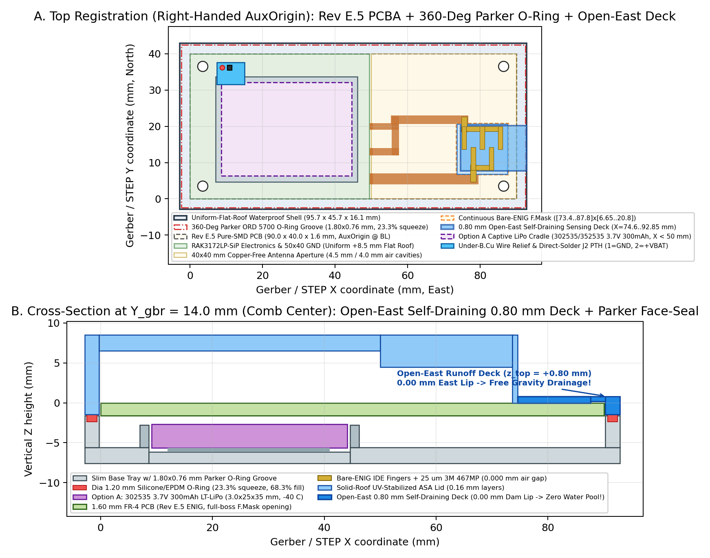 | 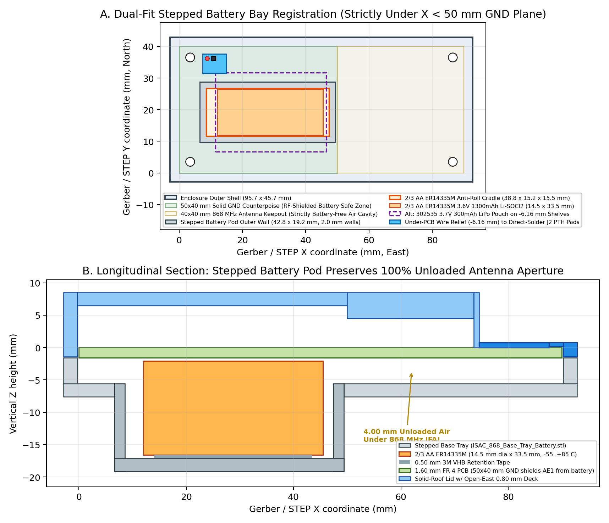 |

---

## 9. Engineering Trade-Offs & `Rev F.0` Roadmap

Designing `Rev E.5` around an inexpensive 2-layer FR-4 stackup and discrete COTS passives involved deliberate trade-offs worth noting before scaling beyond the pilot batch:

1. **2-Layer `FR-4` Dielectric Tolerance ($\varepsilon_r = 4.4 \pm 0.2$):** Standard 2-layer `1.60 mm` FR-4 shifts unloaded antenna resonance by roughly `±8–12 MHz` across laminate lots. Per-unit 2-point factory calibration (`Dry Air` + `Al2O3` ceramic standard) removes most static offset, and pilot bring-up (`B-07`) checks whether the empirical elliptic Pi-filter (`C_M1, C_M2`) needs minor re-centering on physical PCBWay laminate. Moving to an impedance-controlled 4-layer stackup in `Rev F.0` will tighten raw CPWG and antenna repeatability.
2. **Broadband `LT5538` Detector Selectivity:** The `LT5538IDD#TRPBF` input responds from `40 MHz` to `3.8 GHz`. While Listen-Before-Sense (`LBS`) pre/post blanking rejects intermittent LTE/GSM/LoRa bursts, sustained strong out-of-band emitters near a deployment site will cause repeated `FAULT` deferrals rather than clean readings. Adding a miniature `868 MHz` SAW bandpass filter ahead of `U2` Pin 2 (`IN+`) is planned for `Rev F.0`.
3. **Discrete Return-Loss Bridge vs. Monolithic Coupler:** The discrete 8-element bridge achieves `-0.802 dB` insertion loss and `24.81 dB` `50 Ω` directivity using stocked `0402` parts, at the cost of tight parasitic sensitivity on the `/BR_S` node ($C_{\text{par}} < 0.15\text{ pF}$). Evaluating an `0603`/`0805` LTCC directional coupler alongside the discrete bridge is scheduled for `Rev F.0`.
4. **Die Temperature vs. Radome Skin Temperature:** Using the `STM32WLE5JC` internal `ADC_IN12` temperature sensor saves components and roof penetrations, though thermal lag across the internal air gap means rapid radiative frost events near `0 °C` can trail ambient surface temperature. A low-leakage NTC or digital temperature sensor thermally coupled to the inner radome face is planned for `Rev F.0`.

---

## 10. Complete `Rev E.5` Turnkey Bill of Materials

- **Populated Assembly (`DNP = No`):** `38` BOM lines = `67` placed components (single-sided top SMT placements in `fab/cpl/ISAC_868_Turnkey_CPL_Top.csv`, `0` THT parts; `NO SUBSTITUTION` specified on `U1, U2, U3, Q1, Q2, J1`).
- **Do-Not-Populate (`DNP = Yes`):** `8` BOM lines = `10` unpopulated footprints (`C_SMPS3, D_RF, J1, J2, J3, J4, J5, R_DIV1, R_DIV2, R_VUART`) with `0` paste apertures in `F_Paste.gtp` (`J2` provides bare-`ENIG` `Ø0.75 mm` PTH battery wire pads from `B.Cu`; `J3..J5` provide bare-`ENIG` pogo-pin pads for SWD/UART/BOOT bench access).
- **Board-Only Features (`15` footprints, excluded from BOM & CPL):** `AE1` (`IFA_868MHz_ISAC_40x20mm`), `FID1..FID5` (`5 × Ø1.00/2.00 mm` bare-`ENIG` optical fiducials), `H1..H4` (`4 × Ø2.70 mm` ISO 273 `M2.5` NPTH mounting holes), `TP1..TP5` (`Ø1.00 mm` DC test points).

| Item | Designators | Qty | Value | Footprint | MPN | Manufacturer | LCSC / Sourcing | DNP |
| :---: | :--- | :---: | :--- | :--- | :--- | :--- | :--- | :---: |
| 1 | `C_BAT, C_CAPM, C_CAPP, C_INN` | 4 | `1n` | `C_0402_1005Metric` | `GRM1555C1H102JA01D` | Murata | `C76947` | No |
| 2 | `C_BLK, C_RF` | 2 | `100p` | `C_0402_1005Metric` | `GJM1555C1H101JB01D` | Murata | `Authorized: DigiKey/Mouser` | No |
| 3 | `C_BULK1, C_BULK2` | 2 | `47u` | `C_0805_2012Metric` | `GRM21BR61A476ME15L` | Murata | `C124129` | No |
| 4 | `C_DET1, C_IN2, C_LPF, C_OUT2, C_Q1, C_RST, C_U1B, C_U1C, C_VREF` | 9 | `100n` | `C_0402_1005Metric` | `GRM155R71C104KA88D` | Murata | `C71629` | No |
| 5 | `C_DET2, C_OUT1` | 2 | `1u` | `C_0603_1608Metric` | `GRM188R71E105KA12D` | Murata | `C86020` | No |
| 6 | `C_IN1` | 1 | `10u` | `C_0603_1608Metric` | `GRM188R61E106MA73D` | Murata | `C91606` | No |
| 7 | `C_M1` | 1 | `3.6p` | `C_0402_1005Metric` | `GJM1555C1H3R6WB01D` | Murata | `Authorized: DigiKey/Mouser` | No |
| 8 | `C_M2` | 1 | `4.3p` | `C_0402_1005Metric` | `GJM1555C1H4R3WB01D` | Murata | `Authorized: DigiKey/Mouser` | No |
| 9 | `C_MZ` | 1 | `0.5p` | `C_0402_1005Metric` | `GJM1555C1HR50WB01D` | Murata | `Authorized: DigiKey/Mouser` | No |
| 10 | `C_PAV, C_RFV, C_VBAT, C_VDDA2` | 4 | `1u` | `C_0402_1005Metric` | `GRM155R61E105KA12D` | Murata | `C77009` | No |
| 11 | `C_S, C_S2` | 2 | `1.0p` | `C_0402_1005Metric` | `GJM1555C1H1R0WB01D` | Murata | `C161339` | No |
| 12 | `C_SMPS1` | 1 | `4.7u` | `C_0402_1005Metric` | `GRM155R61A475MEAAD` | Murata | `C335105` | No |
| 13 | `C_SMPS2` | 1 | `470n` | `C_0402_1005Metric` | `GRM155R71C474KA01D` | Murata | `C52923` | No |
| 14 | `C_U1A, C_VDDA1` | 2 | `4.7u` | `C_0603_1608Metric` | `GRM188R61E475KE11D` | Murata | `C90057` | No |
| 15 | `D_3V3, D_RST, D_VBAT` | 3 | `PESD5V0S1BA` | `D_SOD-323` | `PESD5V0S1BA,115` | Nexperia | `C19224` | No |
| 16 | `D_SWD, D_UART` | 2 | `PESD5V0U2BT` | `SOT-23` | `PESD5V0U2BT,215` | Nexperia | `Authorized: DigiKey/Mouser` | No |
| 17 | `FB_PA, FB_RF, FB_VDDA` | 3 | `120R@100M` | `L_0402_1005Metric` | `BLM15AG121SN1D` | Murata | `C85812` | No |
| 18 | `FB_SMPS` | 1 | `0R` | `R_0402_1005Metric` | `RC0402JR-070RL` | Yageo | `C60485` | No |
| 19 | `L_M1` | 1 | `8.2n` | `L_0402_1005Metric` | `LQW15AN8N2G00D` | Murata | `Authorized: DigiKey/Mouser` | No |
| 20 | `L_Q` | 1 | `27n` | `L_0402_1005Metric` | `LQW15AN27NG00D` | Murata | `Authorized: DigiKey/Mouser` | No |
| 21 | `L_S` | 1 | `30n` | `L_0402_1005Metric` | `LQW15AN30NG00D` | Murata | `Authorized: DigiKey/Mouser` | No |
| 22 | `L_SMPS` | 1 | `15u` | `L_0805_2012Metric` | `LQH2MCN150K02L` | Murata | `C86089` | No |
| 23 | `Q1` | 1 | `TPS22919DCKR` | `SOT-363_SC-70-6` | `TPS22919DCKR` | Texas Instruments | `Authorized: DigiKey/Mouser` | No |
| 24 | `Q2` | 1 | `NX3008CBKS` | `SOT-363_SC-70-6` | `NX3008CBKS,115` | Nexperia | `C456076` | No |
| 25 | `Q3` | 1 | `AO3401A` | `SOT-23` | `AO3401A` | Alpha & Omega | `C15127` | No |
| 26 | `R1` | 1 | `8.2 (0.1%)` | `R_0402_1005Metric` | `RT0402BRD078R2L` | Yageo | `Authorized: DigiKey/Mouser` | No |
| 27 | `R2` | 1 | `681 (0.1%)` | `R_0402_1005Metric` | `RG1005P-6810-B-T5` | Susumu | `Authorized: DigiKey/Mouser` | No |
| 28 | `R3` | 1 | `3.57k (0.1%)` | `R_0402_1005Metric` | `RG1005P-3571-B-T5` | Susumu | `Authorized: DigiKey/Mouser` | No |
| 29 | `R_B1, R_B2` | 2 | `4.7k (0.1%)` | `R_0402_1005Metric` | `RG1005P-472-B-T5` | Susumu | `Authorized: DigiKey/Mouser` | No |
| 30 | `R_BG` | 1 | `470k` | `R_0402_1005Metric` | `RC0402FR-07470KL` | Yageo | `C482181` | No |
| 31 | `R_BHI, R_BOOT, R_RST` | 3 | `10k` | `R_0402_1005Metric` | `RC0402FR-0710KL` | Yageo | `C60490` | No |
| 32 | `R_BPD, R_PD` | 2 | `100k` | `R_0402_1005Metric` | `RC0402FR-07100KL` | Yageo | `C60491` | No |
| 33 | `R_LPF, R_VAPP` | 2 | `1k` | `R_0402_1005Metric` | `RC0402FR-071KL` | Yageo | `C106235` | No |
| 34 | `R_TERM` | 1 | `56 (0.1%)` | `R_0402_1005Metric` | `RG1005P-560-B-T5` | Susumu | `Authorized: DigiKey/Mouser` | No |
| 35 | `SW1` | 1 | `RESET` | `SW_SPST_B3U-1000P` | `B3U-1000P` | Omron | `C231329` | No |
| 36 | `U1` | 1 | `RAK3172LP-SiP` | `RAK3172LP-SiP_LGA-73_12x12mm_P0.6mm` | `RAK3172LP-SIP-8-SM-NI` | RAKwireless | `Authorized: RAKwireless/Mouser/DigiKey` | No |
| 37 | `U2` | 1 | `LT5538IDD#TRPBF` | `LT5538IDD_DFN-8-1EP_3x3mm_P0.5mm` | `LT5538IDD#TRPBF` | Analog Devices | `Authorized: DigiKey/Mouser` | No |
| 38 | `U3` | 1 | `TPS7A0233DBVR` | `SOT-23-5` | `TPS7A0233DBVR` | Texas Instruments | `C2873330` | No |
| 39 | `C_SMPS3` | 1 | `DNP 100n` | `ISAC:C_0402_1005Metric_DNP_NoPaste` | `GRM155R71C104KA88D` | Murata | `C71629` | **Yes** |
| 40 | `D_RF` | 1 | `DNP` | `ISAC:D_SOD-523_DNP_NoPaste` | `ESD9B5.0ST5G` | onsemi | `Authorized: DigiKey/Mouser` | **Yes** |
| 41 | `J1` | 1 | `DNP SMA_VNA` | `ISAC:SMA_Molex_73251-1153_EdgeMount_Horizontal_HandSolder` | `73251-1153` | Molex | `Authorized: Mouser/DigiKey` | **Yes** |
| 42 | `J2` | 1 | `DNP 1S_BATT` | `JST_PH_B2B-PH-K_1x02` | `B2B-PH-K-S` | JST | `C131337` | **Yes** |
| 43 | `J3` | 1 | `DNP BOOT` | `PinHeader_1x02_P2.54mm` | `PZ254V-11-02P` | XFCN | `C492401` | **Yes** |
| 44 | `J4` | 1 | `DNP SWD` | `PinHeader_1x05_P2.54mm` | `PZ254V-11-05P` | XFCN | `C492404` | **Yes** |
| 45 | `J5` | 1 | `DNP UART` | `PinHeader_1x04_P2.54mm` | `PZ254V-11-04P` | XFCN | `C492403` | **Yes** |
| 46 | `R_DIV1, R_DIV2, R_VUART` | 3 | `DNP 0R` | `ISAC:R_0402_1005Metric_DNP_NoPaste` | `RC0402JR-070RL` | Yageo | `C60485` | **Yes** |

---

## 11. Manufacturing Package, Build & Bench Bring-Up

### 11.1 Turnkey PCBWay Release Archive
[`fab/ISAC_868_RevE5_PCBWay_Turnkey.zip`](fab/ISAC_868_RevE5_PCBWay_Turnkey.zip) (checksums in [`fab/SHA256SUMS.txt`](fab/SHA256SUMS.txt)) contains the single-sided SMT fabrication files: RS-274X Gerbers + X2 `.gbrjob`, Excellon PTH/NPTH drills, IPC-D-356A netlist, 46-line BOM, 67-row top CPL, 3D PCBA `.step` + enclosure `.stl` files, and CAM notes ([`fab/documentation/PCBWAY_TURNKEY_FABRICATION_SPECIFICATION.md`](fab/documentation/PCBWAY_TURNKEY_FABRICATION_SPECIFICATION.md)).

### 11.2 Firmware Build & Host Unit Tests
Prerequisites: `gcc` (host C11 test runner) and `arm-none-eabi-gcc` (`10.3+` / `13.2+` for Cortex-M4 target binaries).

```bash
# Run 370 host HIL assertions + 1,092 Flash NVM assertions and build STM32WLE5JC .elf/.hex/.bin
make -C firmware clean all
```

### 11.3 SWD Provisioning & 2-Point Calibration
Connect an ST-LINK/V3MINIE (`STM32_Programmer_CLI`) to `J4` (`Pins 1..5`: `VAPP_SENSE, SWDIO, SWCLK, GND, NRST`) via a `2.54 mm` 5-pin spring-pogo fixture:

```bash
# 1. Initial uncalibrated pilot bring-up (leaves RDP0 open for SWD debug)
./tools/production_flash.sh \
  --deveui 70B3D57ED0060001 \
  --joineui 70B3D57ED0000001 \
  --uncalibrated-bench \
  --no-rdp

# 2. 2-point calibration (Dry-Air mV tare + Al2O3 ceramic reference offset) + Option-Byte RDP1 lock
./tools/production_flash.sh \
  --deveui 70B3D57ED0060001 \
  --joineui 70B3D57ED0000001 \
  --cal-dry-mv 818,758,883 \
  --cal-ref-cdb 0 \
  --lock-rdp1
```
*(Generated per-unit `AppKey` records are saved locally with `0600` permissions in `provisioning_vault/`, which is git-ignored. Step-by-step pilot bring-up procedures are in [`docs/bringup_report.md`](docs/bringup_report.md).)*

### 11.4 Design & Documentation Verification Scripts
To run the non-destructive DFM, BOM/CPL, schematic/layout consistency, seeded-defect, and documentation parity checks against the frozen `Rev E.5` design:

```bash
PYTHONDONTWRITEBYTECODE=1 python3 tools/rules_isac.py --verify
PYTHONDONTWRITEBYTECODE=1 python3 tools/check_dfm.py
PYTHONDONTWRITEBYTECODE=1 python3 tools/check_bom_cpl.py
PYTHONDONTWRITEBYTECODE=1 python3 tools/verify_design_consistency.py
PYTHONDONTWRITEBYTECODE=1 python3 tools/check_doc_parity.py
PYTHONDONTWRITEBYTECODE=1 python3 tools/test_seeded_defects.py
```
*(For full CAD/EM/turnkey regeneration from scratch when modifying copper geometry on a future revision, run `tools/verify_e2e_release_gate.py`.)*

---

## 12. Repository Structure

```text
├── ISAC_868_KiCad9.kicad_sch / .kicad_pcb / .kicad_pro / .kicad_dru   # KiCad 9.0.8 schematic, 2L RF PCB & DRC rules
├── ISAC.kicad_sym, ISAC.pretty/, 3dmodels/                            # Custom LGA-73, DFN-8, Edge-SMA, DNP & IFA+IDE libraries + STEP
├── firmware/                                                          # Freestanding C11 STM32WLE5JC ISAC + LoRaWAN 1.0.3 EU868 firmware
│   ├── include/   (isac_board_pins.h, isac_sensing.h, isac_lorawan_eu868.h, isac_nvm.h, isac_hal.h)
│   ├── src/       (main_target.c, isac_sensing.c, isac_lorawan_eu868.c, isac_nvm.c, isac_hal_stm32wl.c)
│   └── test/      (test_isac_hil.c [370 assertions], test_isac_nvm.c [1,092 assertions], design_values.json)
├── rf/                                                                # Local EM & circuit solvers
│   ├── cpwg_2dfvm_solver.py                                           # Interface-graded 2D-FVM CPWG impedance solver (51.90 Ohm)
│   ├── fdtd_3d_ant.c & ifa_enclosure_mom.py                           # C99/OpenMP 3D Yee-Grid Maxwell FDTD + elliptic harmonic filter
│   ├── bridge_sparam_mc.py & bridge_loss.py                           # Distributed microstrip bridge [S] + 2,000-trial Monte-Carlo
│   └── results/                                                       # JSON/CSV solver outputs & plots
├── cst_studio/                                                        # CST Studio Suite 3D FIT/FEM antenna, radome & Debye superstrate package
│   ├── macros/    (ISAC_868_Complete_Antenna_MWS.bas, ISAC_868_Setup_FEM_CrossCheck.bas, ISAC_868_Sweep_All_Superstrates.bas, ...)
│   └── python/    (run_cst_batch.py, postprocess_cst_results.py) + cad_exports/, previews/ & results/fdtd_reference/
├── enclosure/                                                         # Parametric ASA/PETG enclosure & watertight STLs
│   ├── gen_enclosure.py & render_enclosure_3d.py                      # Flat-roof + open-East window + Parker O-ring generator
│   └── ISAC_868_Lid_0p80mm_Window.stl / ISAC_868_Base_Tray*.stl       # 3D-printable / CNC-ready solids
├── fab/                                                               # Turnkey release files
│   ├── ISAC_868_RevE5_PCBWay_Turnkey.zip & SHA256SUMS.txt             # Frozen Rev E.5 single-sided SMT Turnkey archive
│   └── gerbers/, bom/, cpl/, netlist/, mechanical/, documentation/    # Individual RS-274X, drill, IPC-D-356, BOM & CPL files
├── docs/                                                              # Technical documentation, PDFs & silicon datasheets
│   ├── ISAC_868MHz_System_Design_and_Operation_Summary.pdf / .md      # System design notes & RF/circuit derivations
│   ├── ISAC_868_Schematic.pdf, ISAC_868_PCB_Top_Sheet.pdf, ...        # Vector schematic, copper & assembly inspection sheets
│   ├── power_budget.md & rf_link_budget.md                            # Rail current/dropout analysis & loaded-radome MCL link budget
│   ├── bringup_report.md & OPEN_ITEMS.md                              # 5-10 board pilot bring-up procedure & open bench measurements
│   └── SOURCES.md, reports/ & datasheet/                              # Footprint verification report & vendor datasheets
├── tools/                                                             # Parametric KiCad scripts, DFM checks & flashing utilities
├── CITATION.cff                                                       # Academic / technical citation metadata
└── LICENSE                                                            # Apache License 2.0
```

---

## 13. Author, Citation & License

- **Author:** Stephen K. Boachie
- **License:** Released under the [Apache License 2.0](LICENSE). Hardware schematics, PCB layout files, enclosure CAD, electromagnetic solvers, and embedded firmware may be used, modified, and distributed under the terms of Apache-2.0.

If you reference this hardware architecture, shared-aperture return-loss bridge, or EM/firmware co-design workflow in academic or industrial work, please cite [`CITATION.cff`](CITATION.cff) or use:

```bibtex
@software{boachie2026lorawan_isac_868,
  author  = {Boachie, Stephen K.},
  title   = {868 MHz LoRaWAN ISAC Surface-Permittivity Sensor Node (Rev E.5)},
  year    = {2026},
  version = {E.5},
  license = {Apache-2.0},
  url     = {https://github.com/abbottsteve/LoRaWAN-ISAC-868MHz}
}
```
