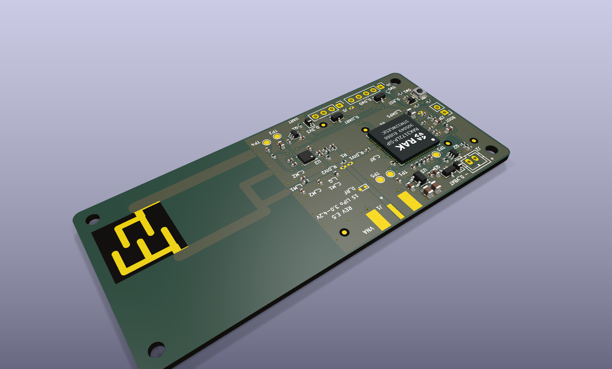
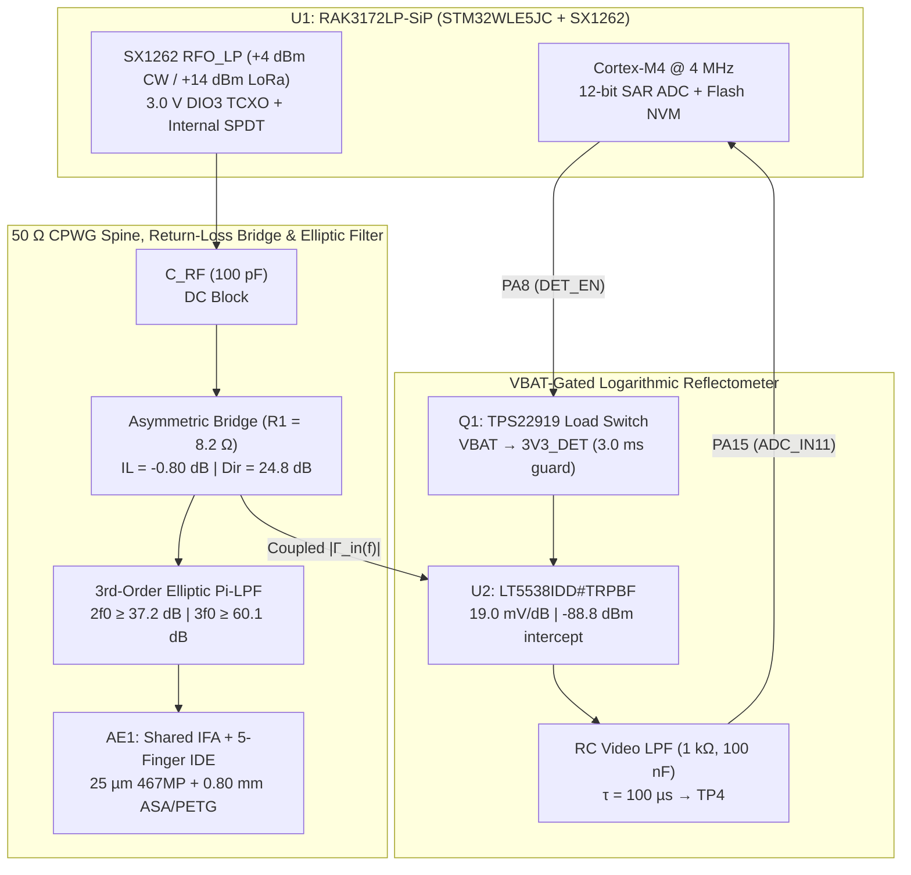

# 868 MHz LoRaWAN ISAC Surface-Permittivity Sensor Node (`Rev E.5`)

[](LICENSE)
[-0A66C2?style=flat-square)](#1-motivation-status--system-specifications)
[](docs/bom_and_enclosure.md)
[-2E7D32?style=flat-square)](docs/firmware_and_pinmap.md)
[](#2-operating-principle--analytical-reflectometer-model)
[](#4-quick-start-build--verification)

An open-hardware Integrated Sensing and Communications (ISAC) sensor node operating in the European 863–870 MHz (EU868) band [6]. Rather than pairing an auxiliary microwave resonator with a separate telemetry radio, the board shares a single Inverted-F + Interdigital Evanescent-Field Antenna (`AE1`) and a single `STM32WLE5JC` / `SX1262` System-in-Package (`RAK3172LP-SIP-8-SM-NI`) across a low-loss (-0.80 dB) asymmetric return-loss bridge to measure near-field surface permittivity through a 0.80 mm radome and transmit Class A LoRaWAN uplinks over the same physical aperture.

| Front-Left Ray-Traced PCBA (90 × 40 mm) | Rear-Right RF Bridge & Sensing Aperture (`AE1`) |
| :---: | :---: |
|  |  |

### Documentation Navigation

| Document | Technical Scope |
| :--- | :--- |
| [**System Design Summary (6-Page PDF)**](docs/ISAC_868MHz_System_Design_and_Operation_Summary.pdf) | Printable A4 technical datasheet covering architecture, analytical signal model, benchmarks, CAD & references |
| [**RF Design, EM Solvers & Limitations**](docs/rf_design_and_simulation.md) | 2D-FVM CPWG cross-section, 2,000-trial bridge Monte-Carlo, 3D-FDTD plots, sensing boundary conditions & `Rev F.0` roadmap |
| [**Firmware, `U1` Pin Map & `FPort 10` Payload**](docs/firmware_and_pinmap.md) | Freestanding C11 execution flow, silicon errata, `RAK3172LP-SiP` LGA-73 pinout + overlay & 10-byte ChirpStack/TTN decoder |
| [**Turnkey BOM, Test Points & Enclosure**](docs/bom_and_enclosure.md) | Complete 46-line BOM, `TP1..TP5` probe map, self-draining ASA/PETG Option A/B blueprints & SWD provisioning CLI |
| [**Power Budget**](docs/power_budget.md) · [**Loaded Link Budget**](docs/rf_link_budget.md) | Split-rail LDO/switch current analysis (`STOP2` 2.85–3.25 µA) & wet-radome SF7/SF9/SF12 link-margin recovery |
| [**CST Studio Suite 3D Package**](cst_studio/README.md) | Parameterized SIMULIA CST Microwave Studio (`FIT` / curved `FEM`), Debye dispersion & Design Studio co-simulation |
| [**Pilot Bring-Up Checklist**](docs/bringup_report.md) · [**Open Items**](docs/OPEN_ITEMS.md) | First-article VNA correlation, 5–10 board pilot verification procedure & ETSI pre-compliance tracker |

---

## 1. Motivation, Status & System Specifications

Detecting glaze ice, water films, or hydrocarbon spills on remote outdoor assets—bridge decks, wind-turbine blades, roadways, and utility enclosures—typically forces a trade-off between optical/ultrasonic fouling and the cost/power overhead of standalone radar sensors. At UHF, the capacitive open end of a planar antenna exhibits strong resonant sensitivity to superstrate permittivity across a thin dielectric wall [1, 3, 4]. Inserting a -0.80 dB asymmetric return-loss bridge ahead of an interdigital-tip Inverted-F antenna lets the LoRa transceiver probe three brief +4.0 dBm CW tones across EU868 to classify surface loading before transmitting telemetry over LoRaWAN.

> **Hardware Status (`Rev E.5` — Pilot Batch in Fabrication):** Schematic, 2-layer PCB, 3D-FDTD and CST Studio models, freestanding C11 firmware, and the single-sided SMT archive ([`fab/ISAC_868_RevE5_PCBWay_Turnkey.zip`](fab/ISAC_868_RevE5_PCBWay_Turnkey.zip)) are frozen at `Rev E.5`. A 5–10 unit pilot batch is currently in turnkey assembly; all RF, sensitivity, and current figures reported here are simulation- and datasheet-derived predictions awaiting physical VNA and chamber correlation ([`docs/OPEN_ITEMS.md`](docs/OPEN_ITEMS.md)).

| Subsystem | `Rev E.5` Specification | Reference / Gate |
| :--- | :--- | :--- |
| **PCB & Finish** | 90.0 × 40.0 × 1.60 mm 2-layer FR-4 (1.51 mm core, $\varepsilon_r = 4.4 \pm 0.2$, 1 oz Cu), IPC-4552 ENIG, bare-ENIG `AE1` window, 0.10 mm top stencil | [`tools/check_dfm.py`](tools/check_dfm.py) |
| **Assembly Counts** | `92` footprints = `67` populated top SMD (`0` THT) + `10` DNP + `15` `BOARD_ONLY`; `131` tented 0.60/0.30 mm vias; 0 DRC / 0 ERC | [`docs/bom_and_enclosure.md`](docs/bom_and_enclosure.md) |
| **Radio / MCU (`U1`)** | `RAK3172LP-SIP-8-SM-NI` (`STM32WLE5JC` + `SX1262` `RFO_LP`, 3.0 V `DIO3` TCXO `0x06`, 15 µH wirewound SMPS); 15,948 B Flash / 408 B RAM | [`docs/firmware_and_pinmap.md`](docs/firmware_and_pinmap.md) |
| **CPWG & Bridge** | 51.90 Ω CPWG ($W = 1.08\text{ mm}, S = 0.28\text{ mm}$); `R1` = 8.2 Ω (`RT0402BRD078R2L`) asymmetric bridge ($C_{\text{par}} = 0.1305\text{ pF}$, IL = -0.802 dB, 50 Ω directivity = 24.81 dB) | [`docs/rf_design_and_simulation.md`](docs/rf_design_and_simulation.md) |
| **Detector (`U2`)** | Analog Devices `LT5538IDD#TRPBF` (19.0 mV/dB), TX-off Listen-Before-Sense blanking ($\le 320\text{ mV}$) & $\le 39.5\text{ mV}$ unpowered swing at +14 dBm TX | [`docs/rf_link_budget.md`](docs/rf_link_budget.md) |
| **Filter & `AE1`** | 3rd-order elliptic Pi-LPF ($2f_0 \ge 37.2\text{ dB}$, $3f_0 \ge 60.1\text{ dB}$); `AE1` bonded via 25 µm 3M 467MP to 0.80 mm ASA/PETG ($f_0 = 869.0\text{ MHz}$, $\eta_{\text{tot}} = 45.5$%, 43.73 MHz/RIU, 17.60 dB `P01` ice contrast) | [`rf/ifa_enclosure_mom.py`](rf/ifa_enclosure_mom.py) |
| **Power & Enclosure** | 1S LiPo or 3.6 V Li-SOCl<sub>2</sub> $\to$ `AO3401A` + 25 nA LDO (`U3`) + `VBAT`-gated `Q1` (2.85–3.25 µA `STOP2`); 95.7 × 45.7 × 16.1 mm open-East O-ring housing | [`docs/power_budget.md`](docs/power_budget.md) |

---

## 2. Operating Principle & Analytical Reflectometer Model



1. **Evanescent Fringing-Field Coupling:** The open end of `AE1` terminates in a 5-finger interdigital comb ($w = 1.30\text{ mm}$, $g = 1.20\text{ mm}$, $1/e$ penetration depth $\delta_E \approx (w + g)/\pi \approx 0.80\text{ mm}$ [1]) laminated directly to the 0.80 mm ASA/PETG window with 25 µm 3M 467MP acrylic adhesive. Superstrate media pull resonance downward from $f_0 = 869.0\text{ MHz}$ (Dry Air) to $776.0\text{ MHz}$ (Water [5]), reshaping the filter-cascaded reflection $\Gamma_{\text{in}}(f_k)$ across $f_1 = 863.1$, $f_2 = 866.5$, and $f_3 = 869.5\text{ MHz}$.
2. **3-Port Bridge Coupling & Ratiometric Detection:** Representing the bridge between `/BR_P` (Port 1), `/BR_Q` (Port 2, terminated in $\Gamma_{\text{in}}$), and `LT5538` `IN+` (Port 3) by its scattering matrix, the coupled RF power at tone $f_k$ ($k \in \{1, 2, 3\}$) is:

$$
P_{\text{det}}(f_k) = P_{\text{TX}} + 20\log_{10}\left\lvert S_{31}(f_k) + \frac{S_{21}(f_k)S_{32}(f_k)\thinspace\Gamma_{\text{in}}(f_k)}{1 - S_{22}(f_k)\thinspace\Gamma_{\text{in}}(f_k)}\right\rvert \quad [\text{dBm}] \qquad \text{(1)}
$$

`LT5538` maps $P_{\text{det}}(f_k)$ to a log-linear DC voltage ($K_{\text{det}} \approx 19.0\text{ mV/dB}$, log-intercept $P_0(T) \approx -88.8\text{ dBm}$), which firmware scales ratiometrically against the factory-calibrated internal bandgap ($V_{\text{REFINT,cal}}$ at 3.000 V, 16-sample oversampled sum $D_{\text{VREFINT}}$) so `VDDA` droop cancels:

$$
V(f_k) = K_{\text{det}}\left[P_{\text{det}}(f_k) - P_0(T)\right], \qquad V_{\text{DDA,true}} = 3000\text{ mV} \times \frac{16 \times V_{\text{REFINT,cal}}}{D_{\text{VREFINT}}} \qquad \text{(2)}
$$

Subtracting the Point-1 Dry-Air tare yields band-edge slope (`Tilt`, $\Delta L_{13}$), curvature (`Notch`, $\Delta N_2$), and calibrated mean reflection (`Level`, $\bar{L}$):

$$
\Delta L_{13} = \frac{V(f_1) - V(f_3)}{K_{\text{det}}} \qquad \text{(3)}
$$

$$
\Delta N_2 = \frac{\tfrac{1}{2}\left[V(f_1) + V(f_3)\right] - V(f_2)}{K_{\text{det}}} \qquad \text{(4)}
$$

$$
\bar{L} = \frac{P_{\text{det}}(f_1) + P_{\text{det}}(f_2) + P_{\text{det}}(f_3)}{3} \qquad \text{(5)}
$$

Because additive PA power offsets $\Delta P_{\text{TX}}$ and common-mode detector intercept drift $\Delta P_0(T)$ enter $V(f_1), V(f_2), V(f_3)$ identically across the 3.6 ms sweep, **both cancel analytically in (3) and (4)**, leaving only residual slope drift ($\approx 0.015\text{ dB/}^\circ\text{C}$) compensated on $\bar{L}$ in (5) via `ADC_IN12` die temperature and Point-2 (Al<sub>2</sub>O<sub>3</sub>) calibration.

---

## 3. Simulated 3-Tone Benchmarks & Physical Scope

> **Simulation Conditions:** +4.0 dBm CW sensing TX, $h_{\text{sup}} = 2.00\text{ mm}$ uniform superstrate on 0.80 mm ASA/PETG + 25 µm 467MP, 2-point calibrated (`VREFINT`/`TSEN` compensated; 3.30 V, 25 °C ADC codes). Both standalone $\lvert\Gamma_{\text{ant}}(f_2)\rvert$ at `AE1` Pad 1 and Pi-filter-cascaded $\lvert\Gamma_{\text{in}}(f_2)\rvert$ at `/BR_Q` ($f_2 = 866.5\text{ MHz}$) are listed; full `FPort = 10` byte encoding is in [`docs/firmware_and_pinmap.md`](docs/firmware_and_pinmap.md).

| Medium (2.0 mm) | $\varepsilon_r^*$ (868 MHz) | $f_0$ [MHz] | $\lvert\Gamma_{\text{ant}}(f_2)\rvert$ [dB] | $\lvert\Gamma_{\text{in}}(f_2)\rvert$ [dB] | $\eta_{\text{tot}}$ | ADC ($f_1/f_2/f_3$) | Tilt [dB] | Notch [dB] | Level [dBm] | SF | State (`FPort 10`) |
| :--- | :---: | :---: | :---: | :---: | :---: | :---: | :---: | :---: | :---: | :---: | :--- |
| **Dry Air** | $1.00 - j0.000$ | 869.0 | -23.69 | -20.83 | 45.5% | 1015/940/1096 | -3.44 | +4.88 | -45.66 | SF7 | `0=DRY_AIR` |
| **PTFE / Oil** | $2.10 - j0.0002$ | 849.0 | -7.04 | -7.14 | 35.4% | 1296/1307/1325 | -1.23 | +0.15 | -33.26 | SF7 | `1=OIL` |
| **Glaze Ice** | $3.20 - j0.003$ | 834.5 | -2.55 | -2.89 | 13.4% | 1419/1418/1419 | -0.01 | +0.06 | -28.63 | SF9 | `2=GLAZE_ICE` |
| **Alumina** (Al<sub>2</sub>O<sub>3</sub>) | $9.80 - j0.002$ | 783.0 | -0.36 | -0.53 | 5.1% | 1495/1476/1458 | +1.56 | +0.03 | -26.19 | SF12 | `3=IPA` (Cal) |
| **IPA** | $6.29 - j6.090$ | 794.0 | -1.63 | -2.19 | 4.8% | 1457/1439/1423 | +1.45 | +0.04 | -27.75 | SF12 | `3=IPA` |
| **Water Film** | $79.9 - j3.810$ | 776.0 | -0.46 | -0.72 | 9.6% | 1487/1472/1458 | +1.22 | +0.04 | -26.35 | SF12 | `4=LIQUID_WATER` |

**Figure 3.1 — Standalone `AE1` 3D-FDTD Return Loss $\lvert\Gamma_{\text{ant}}(f)\rvert$ and Filter-Cascaded Total Efficiency $\eta_{\text{tot}}(f)$:**


**Figure 3.2 — Self-Draining 0.80 mm ASA/PETG Enclosure, 3M 467MP Window & Parker ORD 5700 O-Ring Assembly:**


### Key Physical Boundary Conditions (Full Analysis in [`docs/rf_design_and_simulation.md`](docs/rf_design_and_simulation.md))
- **Thickness–Permittivity Degeneracy ($\varepsilon_r' \times h_{\text{film}}$):** Sub-millimeter condensation films ($h_{\text{sup}} < 0.3\text{ mm} \ll 2\delta_E$) partially load the fringing field and require +4.0 °C thermal gating plus multi-frame persistence in downstream analytics.
- **Narrowband EU868 Skirt Compression:** Above $\varepsilon_r' \ge 6$ ($f_0 < 800\text{ MHz}$), Water-vs-IPA separation relies on ~0.23 dB `Tilt` and ~1.4 dB calibrated `Level` on the upper skirt.
- **Counterpoise Mounting & Out-of-Band Selectivity:** Space the $0.145\lambda_0$ ground plane $\ge 10\text{–}15\text{ mm}$ off structural steel (or tare in-situ), and note that continuous RF jammers defer sweeps via `LBS` until an 868 MHz SAW pre-filter is added in `Rev F.0`.

---

## 4. Quick-Start Build & Verification

Prerequisites: `gcc`, `arm-none-eabi-gcc` (10.3+), and `python3` with KiCad 9 `pcbnew` bindings (for DFM/parity checks).

```bash
# 1. Build freestanding STM32WLE5JC firmware (.elf/.hex/.bin) & run 1,462 host HIL + NVM assertions
make -C firmware clean all

# 2. Run non-destructive KiCad DFM, Turnkey BOM/CPL, schematic-PCB consistency & doc parity gates
PYTHONDONTWRITEBYTECODE=1 python3 tools/rules_isac.py --verify
PYTHONDONTWRITEBYTECODE=1 python3 tools/check_dfm.py
PYTHONDONTWRITEBYTECODE=1 python3 tools/check_bom_cpl.py
PYTHONDONTWRITEBYTECODE=1 python3 tools/verify_design_consistency.py
PYTHONDONTWRITEBYTECODE=1 python3 tools/check_doc_parity.py

# 3. Verify CST Studio VBA macros, Touchstone de-embedding & 8 seeded manufacturing-defect traps
PYTHONDONTWRITEBYTECODE=1 python3 cst_studio/python/run_cst_batch.py --check-macros
PYTHONDONTWRITEBYTECODE=1 python3 cst_studio/python/postprocess_cst_results.py --verify-pipeline
PYTHONDONTWRITEBYTECODE=1 python3 tools/test_seeded_defects.py
```

SWD pogo-clip flashing and 2-point factory calibration commands (`tools/production_flash.sh`) are documented in [`docs/bom_and_enclosure.md`](docs/bom_and_enclosure.md) and [`docs/bringup_report.md`](docs/bringup_report.md).

---

## 5. Repository Structure

```text
├── ISAC_868_KiCad9.kicad_sch / .kicad_pcb / .kicad_pro / .kicad_dru   # Frozen Rev E.5 KiCad 9 schematic, PCB & DRC rules
├── ISAC.kicad_sym, ISAC.pretty/, 3dmodels/                            # Custom LGA-73, DFN-8, DNP & IFA+IDE libraries + STEP
├── firmware/                                                          # Freestanding C11 STM32WLE5JC ISAC + LoRaWAN 1.0.3 stack
├── rf/                                                                # 2D-FVM CPWG, 3D Yee-Grid FDTD & 2,000-trial bridge solvers
├── cst_studio/                                                        # SIMULIA CST Studio Suite 3D FIT/FEM & Debye co-sim package
├── enclosure/                                                         # Parametric flat-roof / open-East ASA/PETG enclosure & STLs
├── fab/                                                               # Frozen Rev E.5 PCBWay Turnkey archive & SHA256SUMS.txt
├── docs/                                                              # Modular engineering manuals, CAD sheets & datasheets
│   ├── ISAC_868MHz_System_Design_and_Operation_Summary.pdf / .md      # 6-page A4 printable design summary
│   ├── rf_design_and_simulation.md                                    # Deep EM solver results, bridge MC & sensing limitations
│   ├── firmware_and_pinmap.md                                         # C11 state machine, U1 LGA-73 pinout & FPort 10 wire contract
│   ├── bom_and_enclosure.md                                           # 46-line Turnkey BOM, TP1..TP5, Option A/B CAD & flashing CLI
│   └── power_budget.md, rf_link_budget.md, bringup_report.md, ...     # Rail/link budgets, pilot checklist, reports & datasheets
├── tools/                                                             # Parametric KiCad generators, DFM/parity gates & flasher
├── CITATION.cff                                                       # GitHub citation metadata (BibTeX / APA)
└── LICENSE                                                            # Apache License 2.0
```

---

## 6. Selected References, Citation & License

1. A. V. Mamishev, K. Sundara-Rajan, F. Yang, Y. Du, and M. Zahn, "Interdigital sensors and transducers," *Proceedings of the IEEE*, vol. 92, no. 5, pp. 808–845, May 2004, doi: [`10.1109/JPROC.2004.826603`](https://doi.org/10.1109/JPROC.2004.826603).
2. G. Marrocco, "The art of UHF RFID antenna design: Impedance-matching and size-reduction techniques," *IEEE Antennas and Propagation Magazine*, vol. 50, no. 1, pp. 66–79, Feb. 2008, doi: [`10.1109/MAP.2008.4494504`](https://doi.org/10.1109/MAP.2008.4494504).
3. B. D. Wiltshire, K. Mirshahidi, K. Golovin, and M. H. Zarifi, "Robust and sensitive frost and ice detection via planar microwave resonator sensor," *Sensors and Actuators B: Chemical*, vol. 301, art. no. 126881, Dec. 2019, doi: [`10.1016/j.snb.2019.126881`](https://doi.org/10.1016/j.snb.2019.126881).
4. B. D. Wiltshire, T. Zarifi, and M. H. Zarifi, "Passive split ring resonator tag configuration for RFID-based wireless permittivity sensing," *IEEE Sensors Journal*, vol. 20, no. 4, pp. 1904–1911, Feb. 2020, doi: [`10.1109/JSEN.2019.2947912`](https://doi.org/10.1109/JSEN.2019.2947912).
5. U. Kaatze, "Complex permittivity of water as a function of frequency and temperature," *Journal of Chemical & Engineering Data*, vol. 34, no. 4, pp. 371–374, Oct. 1989, doi: [`10.1021/je00058a001`](https://doi.org/10.1021/je00058a001).
6. F. Liu, Y. Cui, C. Masouros, J. Xu, T. X. Han, Y. C. Eldar, and S. Buzzi, "Integrated sensing and communications: Toward dual-functional wireless networks for 6G and beyond," *IEEE Journal on Selected Areas in Communications*, vol. 40, no. 6, pp. 1728–1767, Jun. 2022, doi: [`10.1109/JSAC.2022.3156632`](https://doi.org/10.1109/JSAC.2022.3156632).

**Author:** Stephen K. Boachie · **License:** [Apache License 2.0](LICENSE) · **Cite via [`CITATION.cff`](CITATION.cff):**

```bibtex
@software{boachie2026lorawan_isac_868,
  author  = {Boachie, Stephen K.},
  title   = {868 MHz LoRaWAN ISAC Surface-Permittivity Sensor Node (Rev E.5)},
  year    = {2026},
  version = {E.5},
  license = {Apache-2.0},
  url     = {https://github.com/abbottsteve/LoRaWAN-ISAC-868MHz}
}
```
