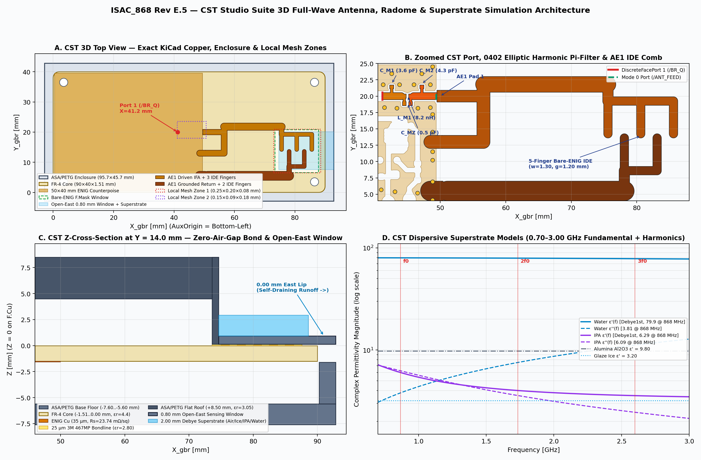

# CST Studio Suite 3D Antenna & Radome Simulation (`Rev E.5`)

Complete 3D full-wave electromagnetic simulation package for the **ISAC_868 (`Rev E.5`)** shared-aperture Inverted-F + Interdigital Evanescent-Field Antenna (`AE1`), `50 × 40 mm` ground counterpoise, 4-element elliptic harmonic Pi-filter (`C_M1, L_M1 || C_MZ, C_M2`), `25 µm` `3M 467MP` adhesive bondline, `ASA/PETG` `0.80 mm` open-East self-draining enclosure, and dispersive dielectric superstrates in **CST Studio Suite (`2022`–`2025`)**.



---

## 1. Engineering Scope & Geometry Provenance

While [`rf/fdtd_3d_ant.c`](../rf/fdtd_3d_ant.c) provides a license-free OpenMP Yee-grid FDTD solver for automated CI verification, CST Studio Suite adds three capabilities valuable before and during pilot VNA correlation:
1. **Perfect Boundary Approximation (`PBA`) & Thin-Sheet (`TST`) Hexahedral FIT Meshing** on curved trace caps, `0.28 mm` CPWG gaps, and the `25 µm` `3M 467MP` bondline without staircase discretization.
2. **Independent Solver Cross-Verification** between CST's Time-Domain Hexahedral (`FIT`, `0.70–3.00 GHz`) and Frequency-Domain Curved-Element Tetrahedral (`FEM`, adaptive energy refinement at `866.5 MHz`) engines.
3. **3D Farfield Pattern, Volumetric Loss Partitioning & Vendor `.s2p` Co-Simulation** across fundamental EU868 tones (`863.1`, `866.5`, `869.5 MHz`) and ETSI `EN 300 220-1` harmonics (`2f0 = 1733.0 MHz`, `3f0 = 2599.5 MHz`).

Every polygon vertex, `0402` component land pad, CPWG clearance channel, and `0.60/0.30 mm` ground via in this directory is extracted read-only from the frozen `Rev E.5` layout ([`ISAC_868_KiCad9.kicad_pcb`](../ISAC_868_KiCad9.kicad_pcb) and [`IFA_868MHz_ISAC_40x20mm.kicad_mod`](../ISAC.pretty/IFA_868MHz_ISAC_40x20mm.kicad_mod)) by [`generate_cst_package.py`](generate_cst_package.py), using the exact right-handed manufacturing coordinate frame:
- **Origin `(0, 0, 0) mm`:** Bottom-left corner of the `90.00 × 40.00 mm` PCB on the top `FR-4` / `F.Cu` interface (`KiCad AuxOrigin = (103.500, 120.000) mm`).
- **`+X` (`0..90 mm`):** East toward the `AE1` radiator and open-East self-draining sensing deck.
- **`+Y` (`0..40 mm`):** North across the `40 mm` board width (`AE1` feed spine on `Y = 20.000 mm`).
- **`+Z` (`mm`):** Vertical normal above the `FR-4` top surface (`F.Cu` = `0..+0.035 mm`, `FR-4` = `-1.510..0.000 mm`, `B.Cu` = `-1.545..-1.510 mm`).

---

## 2. Directory Layout

```text
cst_studio/
├── README.md                                     # CST setup, physics, meshing & workflow guide
├── generate_cst_package.py                       # Extracts exact KiCad Rev E.5 copper -> VBA macros, DXFs & plots
├── macros/
│   ├── ISAC_868_Complete_Antenna_MWS.bas         # Primary CST Microwave Studio 3D builder (TD-FIT, 0.70-3.00 GHz)
│   ├── ISAC_868_Setup_FEM_CrossCheck.bas         # CST Tetrahedral Frequency-Domain (FEM) adaptive cross-check
│   ├── ISAC_868_Sweep_All_Superstrates.bas       # Automated 10-case CST batch sweep -> Touchstone .s1p + Farfields
│   └── ISAC_868_FrontEnd_CoSim_DS.bas            # CST Design Studio (DS) bridge + Murata .s2p + LT5538 setup
├── cad_exports/
│   ├── AE1_and_Filter_F_Cu.dxf                   # Closed R2000 polylines of AE1, CPWG launch, pads & F.Cu GND
│   ├── Counterpoise_B_Cu.dxf                     # B.Cu ground plane with 2.20 x 2.20 mm /BR_S relief
│   ├── Bare_ENIG_Window_F_Mask.dxf               # [73.40..87.80] x [6.65..20.80] mm solder-mask sensing window
│   ├── PCB_Outline_EdgeCuts.dxf                  # 90.00 x 40.00 mm (R = 2.00 mm) board outline + H1..H4 NPTH
│   └── geometry_manifest.json                    # Extracted pad/via coordinates & SHA-256 provenance
├── python/
│   ├── run_cst_batch.py                          # Headless cst.interface / cst.results driver + VBA syntax checker
│   └── postprocess_cst_results.py                # Touchstone .s1p -> Rev E.5 bridge + LT5538 3-tone evaluator
├── previews/
│   └── CST_Simulation_Model_Blueprint.png        # 4-panel CST geometry, mesh, stackup & Debye permittivity view
└── results/
    └── fdtd_reference/*.s1p                      # Pre-built 3D-FDTD Touchstone curves for live CST GUI overlay
```

---

## 3. Physical Stackup, Surface Impedance & Dispersive Materials

### 3.1 Z-Axis Mechanical & Dielectric Stackup (`enclosure_en = 1`)
Boolean `Solid.Insert` operations are ordered in [`ISAC_868_Complete_Antenna_MWS.bas`](macros/ISAC_868_Complete_Antenna_MWS.bas) so copper fingers, vias, solder mask, transfer adhesive, and fasteners share clean conformal interfaces with **zero overlapping-volume warnings**:

| Layer / Component | CST Component:Solid | Z-Span [mm] | Material Model (`0.70–3.00 GHz`) |
| :--- | :--- | :---: | :--- |
| **Enclosure Base Tray** | `Enclosure:ASA_Base_Tray` | `-7.600 .. -1.600` (`4.0 mm` air pocket `-5.60..-1.60`) | `ASA_PETG_Radome` ($\varepsilon_r = 3.05, \tan\delta = 0.012$) |
| **Perimeter O-Ring** | `Enclosure:EPDM_ORing_Outer` | `-2.360 .. -1.440` (`360°` Parker gland) | `EPDM_ORing_5700` ($\varepsilon_r = 2.55, \tan\delta = 0.010$) |
| **Bottom Solder Mask** | `PCB_Mask:Bot_LPI_Mask` | `-1.580 .. -1.510` | `SolderMask_LPI` ($\varepsilon_r = 3.40, \tan\delta = 0.025$) |
| **Bottom `B.Cu` Plane** | `PCB_Copper:Bot_GND_Counterpoise` | `-1.545 .. -1.510` (`X = 0.45..50.00`) | `Copper_ENIG_IPC4552` ($R_s = 23.74\text{ m}\Omega/\square$) |
| **2-Layer `FR-4` Core** | `PCB_Substrate:FR4_Core` | `-1.510 .. 0.000` | `FR4_ISAC_Core` ($\varepsilon_r = 4.40 \pm 0.20, \tan\delta = 0.020$) |
| **Top `F.Cu` & `AE1` IDE** | `PCB_Copper:AE1_*`, `Top_GND_*` | `0.000 .. +0.035` | `Copper_ENIG_IPC4552` ($\sigma_{\text{eq}} = 1.24 \times 10^7\text{ S/m}$) |
| **Top LPI Solder Mask** | `PCB_Mask:Top_LPI_Mask` | `0.000 .. +0.070` (open over `[73.4..87.8]×[6.65..20.8]`) | `SolderMask_LPI` ($\varepsilon_r = 3.40, \tan\delta = 0.025$) |
| **`3M 467MP` Bondline** | `Enclosure:Adhesive_467MP` | `0.000 .. +0.060` (`25 µm` above `AE1` fingers + trench fill) | `Adhesive_3M_467MP` ($\varepsilon_r = 2.80, \tan\delta = 0.015$) |
| **Sensing Window & Lid** | `Enclosure:ASA_Upper_Lid` | `+0.060 .. +0.860` (`0.80 mm` open-East window; `+8.50 mm` roof) | `ASA_PETG_Radome` ($\varepsilon_r = 3.05, \tan\delta = 0.012$) |
| **Test Superstrate Film** | `Superstrate:Superstrate_Film` | `+0.860 .. +2.860` (`h_superstrate = 2.00 mm` default) | Parametric `superstrate_id = 0..5` (see Table 3.2) |

> **Why IPC-4552 `ENIG` Surface Loss Matters (`use_enig_loss = 1`):** Standard electroless nickel (`4.5 µm` `NiP`, $\rho \approx 7.5 \times 10^{-7}\ \Omega\cdot\text{m}, \mu_r \approx 2.0$) beneath `0.05 µm` immersion gold raises RF surface resistance at `866.5 MHz` from `7.7 mΩ/sq` (bare copper) to `23.74 mΩ/sq`. Because current crowds along the edges of the `1.30 mm` interdigital fingers and IFA shorting stub, modeling pure copper over-predicts unloaded Q and radiation efficiency by `~4–6%`. Setting `use_enig_loss = 0` in CST's Parameter List lets you quantify the exact `NiP` loss penalty directly.

### 3.2 Broadband 1st-Order Debye Superstrate Models (`0.70–3.00 GHz`)
Polar fluids exhibit strong dipolar relaxation across `0.7–3.0 GHz`. Instead of fixed-frequency conductivity, `Superstrate_IPA_Debye` and `Superstrate_Water_Debye` use CST's native causal `Debye1st` dispersion model:

| `superstrate_id` | CST Material | Dispersion Type | Parameters | $\varepsilon_r^*(868\text{ MHz})$ |
| :---: | :--- | :---: | :--- | :---: |
| **`0`** | `Superstrate_DryAir` | Normal | $\varepsilon_r = 1.00$ | `1.00 - j0.000` |
| **`1`** | `Superstrate_Oil_PTFE` | `ConstTanD` | $\varepsilon_r = 2.10, \tan\delta = 0.0001$ | `2.10 - j0.0002` |
| **`2`** | `Superstrate_GlazeIce` | `ConstTanD` | $\varepsilon_r = 3.20, \tan\delta = 0.00094$ | `3.20 - j0.003` |
| **`3`** | `Superstrate_Alumina` | `ConstTanD` | $\varepsilon_r = 9.80, \tan\delta = 0.00020$ | `9.80 - j0.002` |
| **`4`** | `Superstrate_IPA_Debye` | `Debye1st` | $\varepsilon_s = 19.90, \varepsilon_\infty = 3.20, \tau = 408.0\text{ ps}$ | `6.29 - j6.090` |
| **`5`** | `Superstrate_Water_Debye` | `Debye1st` | $\varepsilon_s = 80.10, \varepsilon_\infty = 4.90, \tau = 9.30\text{ ps}$ | `79.91 - j3.810` |

---

## 4. Excitation Modes, Meshing & Solver Strategy

### 4.1 Two Selectable Port Planes (`excitation_mode`)
- **`excitation_mode = 1` (Default — Complete Front-End at `/BR_Q`):** Places `50 Ω` `DiscreteFacePort 1` at `X = 41.20 mm, Y = 20.00 mm` (immediately downstream of bridge resistor `R1.2`) and populates CST 3D `LumpedElement` RLC branches (`C_M1 = 3.6 pF`, `L_M1 = 8.2 nH`, `C_MZ = 0.50 pF`, `C_M2 = 4.3 pF` including `0402` ESR/ESL) across their exact KiCad pads and `0.60/0.30 mm` shunt ground vias. This captures physical pad-to-ground fringing, shunt via loop inductance, and radiated harmonic suppression at `1.733 GHz` / `2.600 GHz` in one 3D run.
- **`excitation_mode = 0` (Direct `AE1` Feed Plane at `/ANT_FEED`):** Places `50 Ω` `DiscreteFacePort 1` directly at `AE1` Pad 1 (`X = 49.40 mm, Y = 20.00 mm`) with the Pi-filter omitted. Use this mode to compare against a VNA calibrated at `AE1` (`0 Ω` jumper across `L_M1`, `C_M1/C_M2/C_MZ` open) or to connect the 3D block into **CST Design Studio** ([`ISAC_868_FrontEnd_CoSim_DS.bas`](macros/ISAC_868_FrontEnd_CoSim_DS.bas)) with vendor Murata SimSurfing `.s2p` files.

### 4.2 Local Hexahedral Mesh Refinement Zones
Rather than relying on uniform global `StepsPerWave`, three `MeshSettings` groups enforce sub-millimeter resolution where high field gradients occur while keeping the transient CFL time step fast (`~350k–550k` hexahedral cells total):
1. **`MeshZone_IDE_and_Window` (`0.25 × 0.20 × 0.08 mm`):** Puts `6` cells across each `1.20 mm` interdigital gap and `10` vertical cells across the `0.80 mm` `ASA/PETG` sensing window so evanescent decay into the superstrate is accurately resolved.
2. **`MeshZone_Port_and_Filter` (`0.15 × 0.09 × 0.18 mm`):** Puts `≥ 3` cells across each `0.28 mm` CPWG coplanar ground gap and resolves the `0402` `C_M1 / L_M1 / C_MZ / C_M2` pad gaps cleanly.
3. **`MeshZone_FR4_Substrate` (`0.80 × 0.80 × 0.25 mm`):** Enforces `≥ 6` vertical cells across the `1.51 mm` FR-4 core.

### 4.3 Convergence Criterion (`-45 dB`)
Unloaded `AE1` cascaded with the `0.50 pF` elliptic notch stores high reactive energy near `869 MHz` and `1.733 GHz`. Truncating the CST Time-Domain solver at its `-30 dB` or `-40 dB` default leaves `±0.25 dB` DFT ripple across `f1..f3`, corrupting differential `Tilt` and `Notch`. The macro sets `.SteadyStateLimit "-45"` with `28` pulse widths and `1,151` frequency samples (`2.0 MHz` step across `0.70–3.00 GHz`).

---

## 5. Step-by-Step Execution

### Workflow A — Interactive CST Studio Suite GUI (`Windows` / `Linux`)
1. Launch **CST Studio Suite** and create an empty **3D Microwave & RF → Antennas → Planar** project.
2. Open **Home → Macros → File → Open VBA Macro Editor**, load [`macros/ISAC_868_Complete_Antenna_MWS.bas`](macros/ISAC_868_Complete_Antenna_MWS.bas), and press **`F5` (`Run`)**.
3. Inspect the 3D structure and mesh (**Mesh → Mesh View**). Toggle parameters (`superstrate_id`, `enclosure_en`, `battery_mode`, `h_window`, `fastener_metal_en`) in **View → Parameter List** (`F7` to rebuild).
4. Click **Home → Start Simulation** (`Time Domain Solver`).
5. **Live Overlay vs. In-Repo 3D-FDTD:** Drag any reference Touchstone curve from [`results/fdtd_reference/`](results/fdtd_reference/) (e.g. `02_dry_air_fdtd_ref.s1p` or `07_glaze_ice_fdtd_ref.s1p`) directly onto **`1D Results → S-Parameters`** in the CST Navigation Tree to compare $|S_{11}|$ and phase side-by-side.
6. **Full 10-Scenario Batch Sweep in GUI:** Run [`macros/ISAC_868_Sweep_All_Superstrates.bas`](macros/ISAC_868_Sweep_All_Superstrates.bas) to solve all 10 cases automatically and export `.s1p` + `866.5 MHz` Farfield ASCII files into `<project_folder>/cst_exports/`.
7. **Tetrahedral FEM Cross-Check:** On a copy of the project, run [`macros/ISAC_868_Setup_FEM_CrossCheck.bas`](macros/ISAC_868_Setup_FEM_CrossCheck.bas) and start the **Frequency Domain Solver** (`730–940 MHz`, 2nd-order curved tetrahedra, adaptive energy pass $\Delta S \le 0.005$ at `866.5 MHz`).

### Workflow B — Headless Python CLI (`cst.interface`) & Post-Processing
```bash
# 1. Regenerate CST macros, DXF exports & blueprint from KiCad Rev E.5 (optional; already generated)
PYTHONDONTWRITEBYTECODE=1 python3 cst_studio/generate_cst_package.py

# 2. Offline VBA syntax & CST History-block balance check (no CST license required)
PYTHONDONTWRITEBYTECODE=1 python3 cst_studio/python/run_cst_batch.py --check-macros

# 3. Run all 10 scenarios headlessly via CST Studio's Python library -> cst_studio/results/*.s1p
PYTHONDONTWRITEBYTECODE=1 python3 cst_studio/python/run_cst_batch.py \
  --cst-root "/opt/cst/CST_Studio_Suite_2024" \
  --all

# 4. Evaluate Rev E.5 Return-Loss Bridge + LT5538 3-Tone Classifier & compare CST vs. 3D-FDTD
PYTHONDONTWRITEBYTECODE=1 python3 cst_studio/python/postprocess_cst_results.py \
  --results-dir cst_studio/results \
  --mode 1
```

---

## 6. Expected Benchmark Correlation Targets (3D-FDTD Baseline)

When correlating CST Time-Domain (`FIT`) and Frequency-Domain (`FEM`) outputs against [`rf/results/ifa_fullwave_3d.json`](../rf/results/ifa_fullwave_3d.json), PBA subcell edge treatment typically agrees within `±4–8 MHz` on unloaded $f_0$ (within half the `FR-4` $\varepsilon_r = 4.4 \pm 0.2$ laminate lot spread) while preserving monotonic dielectric detuning slope:

| Case Tag | Scenario | 3D-FDTD $f_0$ [MHz] | 3D-FDTD $|S_{11}|_{866.5}$ [dB] | 3D-FDTD $\eta_{\text{tot}}$ [%] | `Tilt` [dB] | `Level` [dBm] | Expected Firmware Class |
| :--- | :--- | :---: | :---: | :---: | :---: | :---: | :--- |
| `01_bare_pcb` | Bare PCB (`enclosure_en=0`) | `940.0` | `-1.34` | `14.2%` | — | — | *(Unenclosed VNA check)* |
| `02_dry_air` | Enclosed Dry Air ($\varepsilon_r'=1.00$) | `869.0` | `-20.83` | `45.5%` | `-3.44` | `-45.66` | `DRY_AIR` (`SF7`) |
| `06_oil_ptfe` | Oil / PTFE ($\varepsilon_r'=2.10$) | `849.0` | `-7.62` | `35.4%` | `-1.23` | `-33.26` | `OIL` (`SF7`) |
| `07_glaze_ice` | Glaze Ice ($\varepsilon_r'=3.20$) | `834.5` | `-3.35` | `13.4%` | `-0.01` | `-28.63` | `GLAZE_ICE` (`SF9`) |
| `08_alumina_al2o3` | Alumina `Al2O3` ($\varepsilon_r'=9.80$) | `783.0` | `-1.27` | `5.1%` | `+1.56` | `-26.19` | `IPA` *(Point-2 Cal Ref)* |
| `09_ipa_debye` | IPA (`Debye1st`, `6.29 - j6.09`) | `794.0` | `-2.15` | `4.8%` | `+1.45` | `-27.75` | `IPA` (`SF12`) |
| `10_water_debye` | Water (`Debye1st`, `79.9 - j3.81`) | `776.0` | `-1.38` | `9.6%` | `+1.22` | `-26.35` | `LIQUID_WATER` (`SF12`) |
