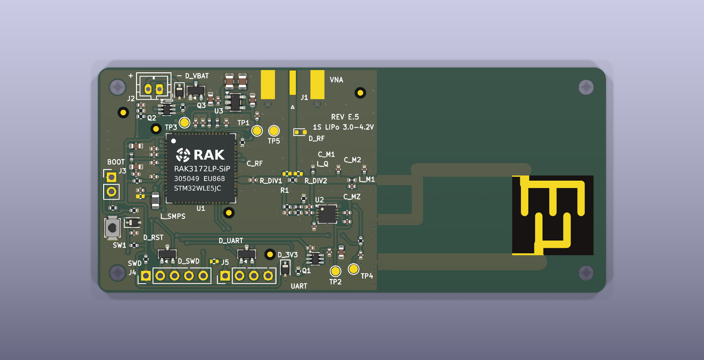
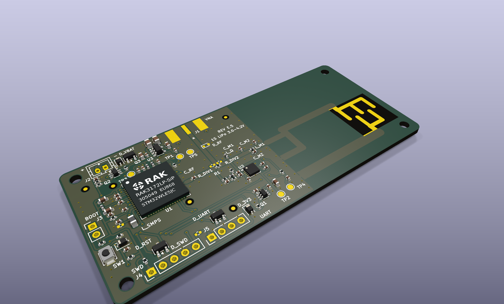
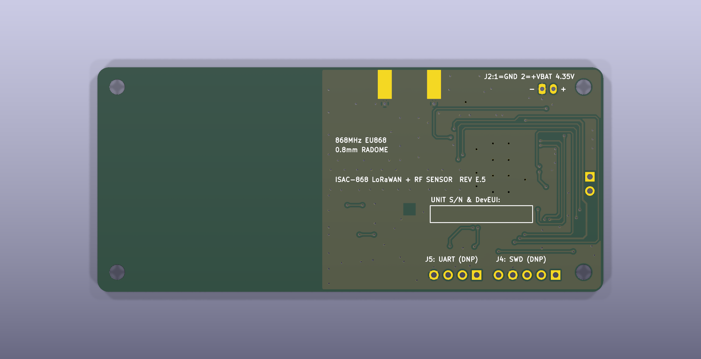
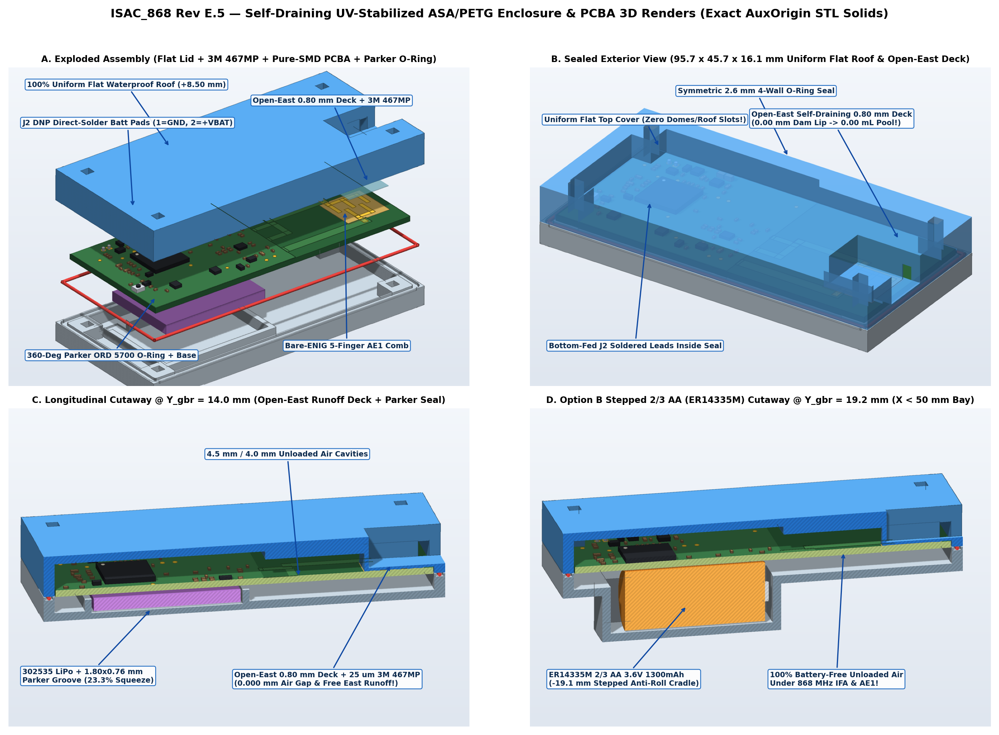
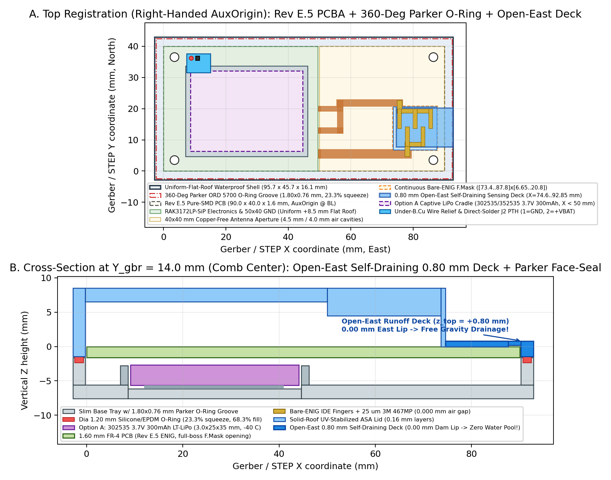

# ISAC 868 MHz LoRaWAN Antenna-Sensor — System Design & Manufacturing Summary (`Rev E.5`)

**Author:** Stephen K. Boachie  
**Revision:** Hardware Revision E.5 (`Rev E.5`, `fab/ISAC_868_RevE5_PCBWay_Turnkey.zip`)  
**Target Radio / MCU:** RAKwireless `RAK3172LP-SIP-8-SM-NI` (`STM32WLE5JC` + `SX1262` `RFO_LP`, 3.0 V `DIO3` TCXO `0x06`, EU868)  
**License:** Apache License 2.0

---

## 1. Architecture Overview

`ISAC_868_KiCad9` (`Rev E.5`) integrates **868 MHz LoRaWAN Class A telemetry** (+14.0 dBm uplink with adaptive SF7/SF9/SF12 wet-radome link recovery) and **near-field dielectric reflectometry** (+4.0 dBm 3-tone CW probing at 863.1, 866.5, and 869.5 MHz; < 1.25 ms dwell per tone) onto a single 90.00 × 40.00 × 1.60 mm 2-layer FR-4 PCBA (1.51 mm core, 1 oz ENIG finish, 67 populated top-side SMD parts, 0 THT parts). The board mounts inside a flat-roof UV-stabilized ASA/PETG housing (95.7 × 45.7 × 16.1 mm) sealed by a perimeter Parker ORD 5700 EPDM face-seal O-ring and laminated across its thinned 0.80 mm open-East sensing window with 25 µm 3M 467MP acrylic transfer adhesive.

### 1.1 Shared IFA + Interdigital Evanescent-Field Antenna (`AE1`) & Elliptic Harmonic Filter
- Synthesized with an OpenMP 3D Yee-grid FDTD solver (`rf/fdtd_3d_ant.c` and `rf/ifa_enclosure_mom.py`) incorporating IPC-4552 ENIG (`NiP/Au`) surface resistance ($R_s = 23.74\text{ m}\Omega/\square$) and substrate/radome dielectric loss. Under unloaded Dry Air inside the enclosure, resonance occurs at $f_0 = 869.0\text{ MHz}$ with standalone $\lvert\Gamma_{\text{ant}}(f_2)\rvert = -23.69\text{ dB}$ at `AE1` Pad 1, filter-cascaded $\lvert\Gamma_{\text{in}}(f_2)\rvert = -20.83\text{ dB}$ at `/BR_Q` ($f_2 = 866.5\text{ MHz}$), worst-case $\lvert\Gamma_{\text{in}}\rvert \le -10.21\text{ dB}$ across 863–870 MHz over FR-4 $\varepsilon_r \in \{4.2, 4.4, 4.6\}$, total efficiency $\eta_{\text{tot}}$ = 45.5% ($\eta_{\text{rad}}$ = 50.0%), and 43.73 MHz/RIU Air-to-Ice resonant sensitivity (869.0 MHz $\to$ 834.5 MHz).
- A 3rd-order elliptic low-pass Pi-filter (`C_M1` = 3.6 pF `GJM1555C1H3R6WB01D`, `L_M1` = 8.2 nH `LQW15AN8N2G00D` $\parallel$ `C_MZ` = 0.5 pF `GJM1555C1HR50WB01D`, `C_M2` = 4.3 pF `GJM1555C1H4R3WB01D`) suppresses $2f_0$ (1.733 GHz) by $\ge 37.2\text{ dB}$ and $3f_0$ (2.600 GHz) by $\ge 60.1\text{ dB}$ across dry and water-loaded VSWR states (ETSI EN 300 220-1 limit $\le -36\text{ dBm}$).
- A solder-mask-free bare-ENIG opening (`X_gbr = [73.40..87.80] mm, Y_gbr = [6.65..20.80] mm`, with silkscreen excluded from `X_gbr >= 50.0 mm`) keeps LPI mask ridges out of the bonded 0.80 mm sensing window.

### 1.2 Asymmetric Microstrip Return-Loss Bridge & 2-Point Calibrated Reflectometer
- Built around a Yageo `RT0402BRD078R2L` (8.2 Ω ±0.1%) inline sense resistor `R1`, 0.1% Susumu `RG1005P` reference arms (`R2` = 681 Ω, `R3` = 3.57 kΩ, `R_TERM` = 56 Ω), ±2% Murata `LQW15AN` inductors (`L_Q` = 27 nH, `L_S` = 30 nH), ±0.05 pF `GJM1555C1H` capacitors (`C_S = C_S2` = 1.0 pF), and an Analog Devices `LT5538IDD#TRPBF` logarithmic detector ($Z_{\text{IN+}} = 291.65\ \Omega \parallel 1.194\text{ pF}$ at 866.5 MHz).
- Opening a 2.20 × 2.20 mm `F.Cu`/`B.Cu` ground cutout beneath `/BR_S` ($C_{\text{par}} = 0.1305\text{ pF} < 0.15\text{ pF}$) achieves -0.802 dB main-path insertion loss, 24.81 dB 50 Ω directivity at 866.5 MHz, and 17.60 dB 1st-percentile (`P01`) Air-to-Ice contrast across 2,000 Monte-Carlo trials.
- Probing at +4.0 dBm keeps `LT5538IDD#TRPBF` (`U2`) input power $\le -25.40\text{ dBm}$ (12.4 dB below its -13 dBm compression point), while unpowered +14 dBm LoRaWAN transmissions induce $\le 39.5\text{ mV}$ peak at `U2 IN+` up to 6:1 VSWR. Two-point calibration (Dry-Air tare + sintered Al2O3 reference offset `cal_ref_cdb`, combined with 0.015 dB/°C residual thermal slope trim and TX-off Listen-Before-Sense blanking) yields 99.72% Water-vs-IPA separation (`P01` margin 0.65 dB $\ge$ 0.50 dB) in simulation.

### 1.3 Split-Rail Power Tree & Freestanding C11 Firmware
- `J2` (`B2B-PH-K-S`) and bench headers `J1, J3, J4, J5` are marked `DNP = Yes` for single-pass top SMT assembly; silicone 24–26 AWG battery leads solder from `B.Cu` into `J2` (`Pad 1` = `GND`, `Pad 2` = `+VBAT_RAW`, 4.35 V DC max).
- `Q3` (`AO3401A` ideal-diode P-MOSFET) feeds `U3` (`TPS7A0233DBVR` 25 nA LDO), while `Q1` (`TPS22919DCKR`) powers `LT5538` directly from `VBAT` so `U3` sees at most 24.1 mA (preserving 3.0 V TCXO headroom down to 3.00 V cell cutoff). `L_SMPS` (`LQH2MCN150K02L`, $I_{\text{sat}} = 300\text{ mA}$) feeds the internal `SX1262` buck converter, and `Q2` (`NX3008CBKS,115`) gates battery division on `PA9` for 150 µs.
- Freestanding C11 firmware (15,948 B Flash, 408 B RAM) implements LoRaWAN 1.0.3 EU868 Class A MAC/crypto, §7 Join backoff, rolling 1-hour ETSI duty-cycle accounting, and dual-page CRC-32 Flash NVM with 72-bit `ECCD` `NMI` recovery.

---

## 2. Analytical Reflectometer & Ratiometric Signal Model

For an input reflection coefficient $\Gamma_{\text{in}}$ at `/BR_Q` across probe tones $f_k \in \{863.1, 866.5, 869.5\}\text{ MHz}$, the coupled power delivered to `LT5538` (`Port 3`) is governed by bridge directivity leakage $S_{31}$ and reflection tracking $S_{21}S_{32}$:

$$
P_{\text{refl}}(f_k) = P_{\text{TX}} + 20\log_{10}\left\lvert S_{31}(f_k) + \frac{S_{21}(f_k)S_{32}(f_k)\thinspace\Gamma_{\text{in}}(f_k)}{1 - S_{22}(f_k)\thinspace\Gamma_{\text{in}}(f_k)}\right\rvert \qquad \text{(1)}
$$

The logarithmic detector converts $P_{\text{refl}}(f_k)$ into baseband voltage $V(f_k) = K_{\text{det}}[P_{\text{refl}}(f_k) - P_0(T)]$ with nominal slope $K_{\text{det}} = 19.0\text{ mV/dB}$ and temperature-dependent log-intercept $P_0(T)$. Firmware scales each 16× oversampled ADC reading ratiometrically against the factory-trimmed `STM32WLE5JC` internal bandgap ($V_{\text{REFINT,cal}}$ at 3.000 V, 16-sample oversampled code sum $D_{\text{VREFINT}}$):

$$
V_{\text{DDA,true}} = 3000\text{ mV} \times \frac{16 \times V_{\text{REFINT,cal}}}{D_{\text{VREFINT}}} \qquad \text{(2)}
$$

After subtracting the Point-1 Dry-Air baseline tare, firmware forms three features—band-edge slope (`Tilt`, $\Delta L_{13}$), in-band curvature (`Notch`, $\Delta N_2$), and mean coupled power (`Level`, $\bar{L}$):

$$
\Delta L_{13} = \frac{V(f_1) - V(f_3)}{19.0\text{ mV/dB}} \qquad \text{(3)}
$$

$$
\Delta N_2 = \frac{\tfrac{1}{2}[V(f_1) + V(f_3)] - V(f_2)}{19.0\text{ mV/dB}} \qquad \text{(4)}
$$

$$
\bar{L} = \frac{P_{\text{refl}}(f_1) + P_{\text{refl}}(f_2) + P_{\text{refl}}(f_3)}{3} \qquad \text{(5)}
$$

Because $P_{\text{TX}}$ and $P_0(T)$ enter $V(f_1)$, $V(f_2)$, and $V(f_3)$ additively, common-mode PA output variations $\Delta P_{\text{TX}}$ and first-order detector intercept drift $\Delta P_0(T)$ cancel identically in (3) and (4), leaving only residual slope drift ($\approx 0.015\text{ dB/}^\circ\text{C}$) compensated on $\bar{L}$ in (5) via `ADC_IN12` die temperature.

---

## 3. Summary Specifications & 3D-FDTD Benchmarks

| Subsystem Metric | Design / Simulated Value | Target |
| :--- | :---: | :---: |
| PCB & Assembly Counts | 92 footprints (67 SMD pop, 0 THT; 10 DNP incl. `J2`; 15 `BOARD_ONLY`), 131 tented vias | 0 ERC, 0 DRC, 0 DNP paste |
| Surface Finish, Mask & CPWG $Z_0$ | IPC-4552 ENIG; 0.035 mm global / 0.025 mm `U1,U2` NSMD ($\ge 0.180\text{ mm}$ dams); $Z_0 = 51.90\ \Omega$ (51.2–57.1 Ω, RL $\ge 26.8\text{ dB}$) | `ImpedanceControlled = False` |
| Bridge Through Loss & Directivity | $\lvert S_{21}\rvert = -0.802\text{ dB}$, Directivity(866.5 MHz) = 24.81 dB ($C_{\text{par}} = 0.1305\text{ pF}$) | $\ge 22.0\text{ dB}$ ($< 0.15\text{ pF}$) |
| 2-Point Calibrated 2,000-Trial MC | Air-to-Ice `P01` = 17.60 dB (100% yield); Water-vs-IPA `P01` = 0.65 dB (99.72% yield) | `P01` $\ge 8.0\text{ dB}$ / $\ge 0.50\text{ dB}$ |
| Enclosed `AE1` Match & Efficiency | $f_0 = 869.0\text{ MHz}$, $\lvert\Gamma_{\text{ant}}(f_2)\rvert = -23.69\text{ dB}$ (`AE1`), $\lvert\Gamma_{\text{in}}(f_2)\rvert = -20.83\text{ dB}$ (`/BR_Q`), $\eta_{\text{tot}}$ = 45.5% | $\lvert\Gamma_{\text{in}}\rvert \le -10.0\text{ dB}$ all $\varepsilon_r$ |
| Harmonic Pi-Filter ($2f_0$ / $3f_0$) | 37.20 dB (1.733 GHz) / 60.08 dB (2.600 GHz) enclosed (37.46 / 60.65 dB water) | $\ge 28\text{ dB}$ / $\ge 45\text{ dB}$ |
| Weatherproof Enclosure (95.7 × 45.7 × 16.1 mm) | Flat +8.50 mm roof + 0.80 mm open-East ASA/PETG window + 25 µm 3M 467MP + Parker ORD 5700 O-ring (M2.5 × 22 mm corner screws) | Watertight 2-manifold (0 clashes) |

### 3D-FDTD 3-Tone Benchmark Table (+4.0 dBm CW Sensing, $h_{\text{sup}} = 2.0\text{ mm}$, 2-Point Calibrated)

> **Reference Planes:** $\lvert\Gamma_{\text{ant}}(f_2)\rvert$ is standalone at `AE1` Pad 1 ($f_2 = 866.5\text{ MHz}$); $\lvert\Gamma_{\text{in}}\rvert$ is cascaded with the elliptic Pi-filter at `/BR_Q`.

| External Superstrate (2.0 mm on 0.80 mm ASA/PETG) | $\varepsilon_r^*$ (868 MHz) | $f_{\text{res}}$ [MHz] | $\lvert\Gamma_{\text{ant}}(f_2)\rvert$ [dB] | Cascaded $\lvert\Gamma_{\text{in}}\rvert$ ($f_1 / f_2 / f_3$) [dB] | Tilt $\Delta L_{13}$ [dB] | Notch $\Delta N_2$ [dB] | Level $\bar{L}$ [dBm] | `FPort 10` State |
| :--- | :---: | :---: | :---: | :---: | :---: | :---: | :---: | :--- |
| Dry Air | $1.00 - j0.000$ | 869.0 | -23.69 | -18.79 / -20.83 / -18.33 | -3.44 | +4.88 | -45.66 | `0 = DRY_AIR` |
| PTFE / Oil | $2.10 - j0.0002$ | 849.0 | -7.04 | -8.72 / -7.14 / -5.99 | -1.23 | +0.15 | -33.26 | `1 = OIL` |
| Glaze Ice | $3.20 - j0.003$ | 834.5 | -2.55 | -3.65 / -2.89 / -2.32 | -0.01 | +0.06 | -28.63 | `2 = GLAZE_ICE` |
| Alumina (Al2O3) | $9.80 - j0.002$ | 783.0 | -0.36 | -0.36 / -0.53 / -0.69 | +1.56 | +0.03 | -26.19 | `3 = IPA` (Cal Ref) |
| IPA (868 MHz) | $6.29 - j6.090$ | 794.0 | -1.63 | -2.27 / -2.19 / -2.12 | +1.45 | +0.04 | -27.75 | `3 = IPA` |
| Water Film | $79.9 - j3.810$ | 776.0 | -0.46 | -0.71 / -0.72 / -0.71 | +1.22 | +0.04 | -26.35 | `4 = LIQUID_WATER` |

---

## 4. Physical Sensing Limitations & Deployment Boundary Conditions

1. **Film-Thickness vs. Permittivity Degeneracy ($\varepsilon_r' \times h_{\text{film}}$):** Planar fringing-field sensors measure an effective superstrate capacitance weighted over the evanescent decay length $\delta_E \approx (g + w)/\pi \approx 0.80\text{ mm}$ [1]. Benchmarks in Section 3 assume a continuous $h_{\text{sup}} = 2.0\text{ mm}$ layer ($> 2\delta_E$). A sub-millimeter water film ($h_{\text{sup}} < 0.3\text{ mm}$) or sparse droplets only partially load the evanescent zone and can traverse intermediate $(\Delta L_{13}, \bar{L})$ loci similar to thicker oil or ice layers; thermal gating ($\le +4.0\ ^\circ\text{C}$ for `GLAZE_ICE`) and multi-interval persistence should be applied in field analytics.
2. **Narrowband Skirt Compression & Mounting Counterpoise Coupling:** Because EU868 restricts probing to a 6.4 MHz window (0.74% fractional bandwidth), media with $\varepsilon_r' \ge 6$ pull $f_0$ below 800 MHz, compressing Water-vs-IPA contrast onto the high-reflection skirt (~0.23 dB in $\Delta L_{13}$, ~1.4 dB in $\bar{L}$). Furthermore, on a 50 × 40 mm ground plane ($0.145\lambda_0$), `B.Cu` chassis currents participate in radiation [2]; mounting directly onto structural steel alters input impedance unless spaced off by a dielectric bracket or tared in-situ via `--cal-dry-mv`.
3. **2-Layer FR-4 Tolerance & Out-of-Band Detector Selectivity:** Uncontrolled 2-layer FR-4 ($\varepsilon_r = 4.4 \pm 0.2$) and 0402 pad capacitance around `C_MZ = 0.5 pF` require first-article VNA verification (`O-02`), while the broadband 40 MHz–3.8 GHz `LT5538` input relies on Listen-Before-Sense blanking until an 868 MHz SAW pre-filter is added in `Rev F.0`.

---

## 5. CAD & Mechanical Renderings (`Rev E.5`)

---

## 6. Selected Literature References

1. A. V. Mamishev, K. Sundara-Rajan, F. Yang, Y. Du, and M. Zahn, "Interdigital sensors and transducers," *Proc. IEEE*, vol. 92, no. 5, pp. 808–845, May 2004, doi: `10.1109/JPROC.2004.826603`.
2. G. Marrocco, "The art of UHF RFID antenna design: Impedance-matching and size-reduction techniques," *IEEE Antennas Propag. Mag.*, vol. 50, no. 1, pp. 66–79, Feb. 2008, doi: `10.1109/MAP.2008.4494504`.
3. B. D. Wiltshire, K. Mirshahidi, K. Golovin, and M. H. Zarifi, "Robust and sensitive frost and ice detection via planar microwave resonator sensor," *Sens. Actuators B, Chem.*, vol. 301, art. no. 126881, Dec. 2019, doi: `10.1016/j.snb.2019.126881`.
4. B. D. Wiltshire, T. Zarifi, and M. H. Zarifi, "Passive split ring resonator tag configuration for RFID-based wireless permittivity sensing," *IEEE Sensors J.*, vol. 20, no. 4, pp. 1904–1911, Feb. 2020, doi: `10.1109/JSEN.2019.2947912`.
5. U. Kaatze, "Complex permittivity of water as a function of frequency and temperature," *J. Chem. Eng. Data*, vol. 34, no. 4, pp. 371–374, Oct. 1989, doi: `10.1021/je00058a001`.
6. F. Liu *et al.*, "Integrated sensing and communications: Toward dual-functional wireless networks for 6G and beyond," *IEEE J. Sel. Areas Commun.*, vol. 40, no. 6, pp. 1728–1767, Jun. 2022, doi: `10.1109/JSAC.2022.3156632`.
