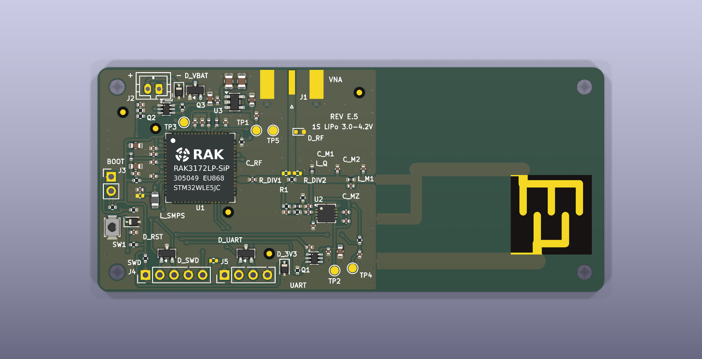
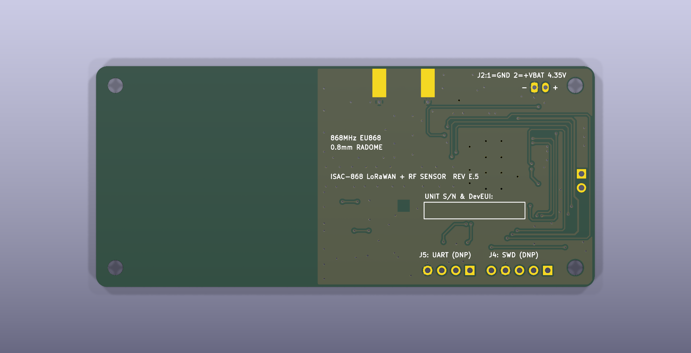
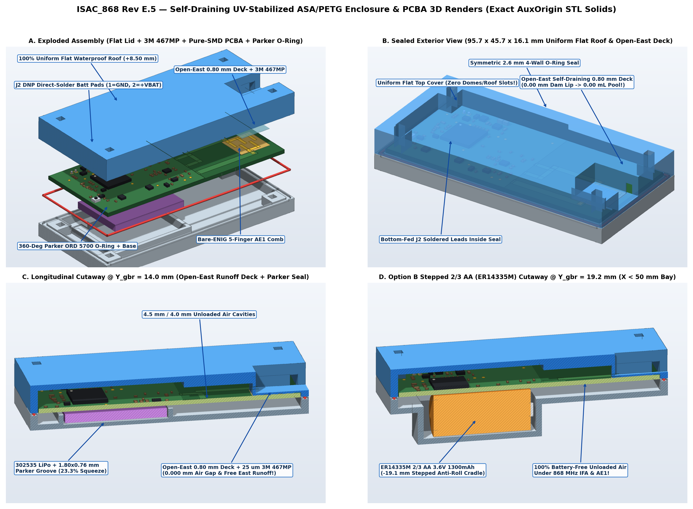
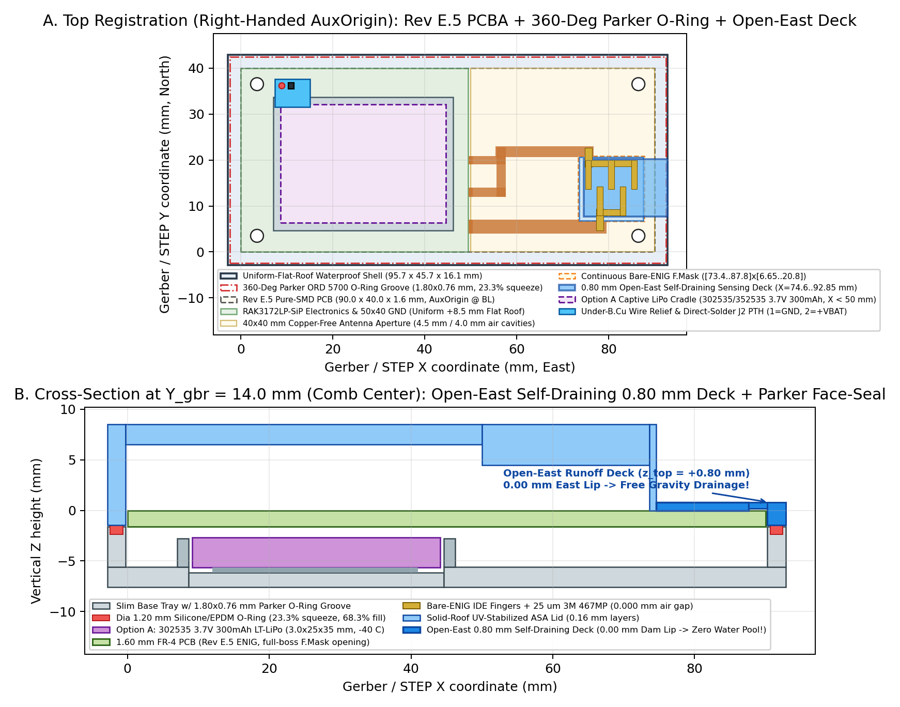
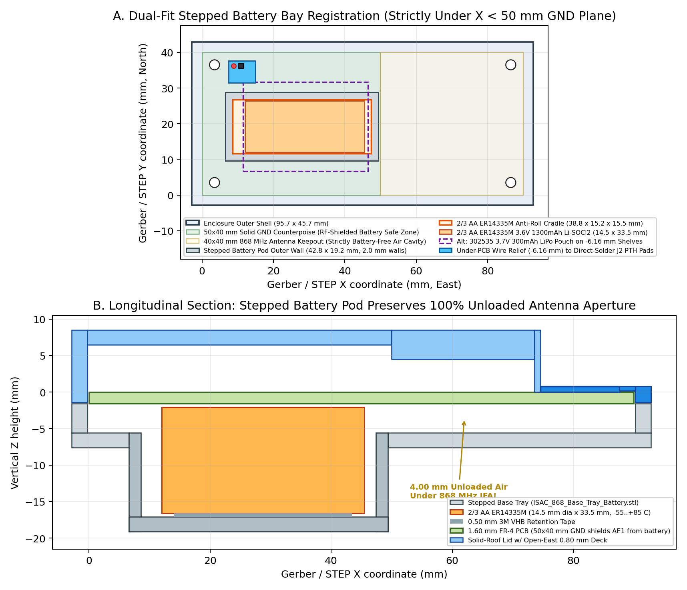

# Turnkey Bill of Materials, Test Points, Mechanical Enclosure & Provisioning (`Rev E.5`)

**Author:** Stephen K. Boachie  
**Hardware Revision:** `Rev E.5` ([`../README.md`](../README.md) · [`../fab/ISAC_868_RevE5_PCBWay_Turnkey.zip`](../fab/ISAC_868_RevE5_PCBWay_Turnkey.zip))

---

## 1. PCBA Inspection Views & DC Test-Point Map (`TP1..TP5`)

| Top Ray-Traced PCBA View (`F.Cu` — 67 SMD Parts) | Bottom Ray-Traced PCBA View (`B.Cu` Continuous Ground Plane) |
| :---: | :---: |
|  |  |

Full rail dropout, `Q1`/`Q2`/`Q3` switching transients, and SAR ADC acquisition budgets are documented in [`power_budget.md`](power_budget.md). All five Ø1.00 mm bare-ENIG test pads sit strictly on DC or low-frequency baseband nodes so probe capacitance (~1.5 pF) never perturbs the 868 MHz return-loss bridge or CPWG spine:

| Test Point | Schematic Net | Gerber $(X_{\text{gbr}}, Y_{\text{gbr}})$ [mm] | Bring-Up / Fixture Measurement Role |
| :---: | :--- | :---: | :--- |
| **`TP1`** | `3V3` | (28.200, 28.750) | Regulated 3.30 V always-on LDO output (`U3.5`) |
| **`TP2`** | `3V3_DET` | (42.100, 3.800) | `VBAT`-switched `U2` (`LT5538IDD#TRPBF`) supply rail (`Q1.6`, verify $\le 1.6\text{ ms}$ rise) |
| **`TP3`** | `VBAT` | (15.350, 30.200) | Post-`Q3` (`AO3401A`) reverse-protected 1S battery rail |
| **`TP4`** | `/DET_ADC` | (45.300, 4.200) | Filtered `LT5538` analog log-detector output (`PA15 / ADC_IN11`, 4.04 mm clear of `L_SMPS`) |
| **`TP5`** | `GND` | (31.200, 28.750) | Low-inductance DMM / oscilloscope ground reference |

> **Selective Silkscreen & Assembly Drawing Convention:** To preserve minimal RF/SMPS loop inductance and prevent silkscreen ridges inside the bonded `AE1` window (`X >= 50.0 mm`), 33 bench/IC/RF-tuning designators are printed on `F.SilkS`, while 100% of all component outlines and designators appear on [`ISAC_868_Assembly_Top.pdf`](ISAC_868_Assembly_Top.pdf) (`F.Fab`).

---

## 2. Complete `Rev E.5` Turnkey Bill of Materials (46 Lines)

- **Populated Assembly (`DNP = No`):** 38 BOM lines = `67` placed components (single-sided top SMT placements in [`../fab/cpl/ISAC_868_Turnkey_CPL_Top.csv`](../fab/cpl/ISAC_868_Turnkey_CPL_Top.csv), `0` THT parts; `NO SUBSTITUTION` specified on `U1, U2, U3, Q1, Q2, J1`). Exact KiCad library footprint strings are archived in [`../fab/bom/ISAC_868_Turnkey_BOM.csv`](../fab/bom/ISAC_868_Turnkey_BOM.csv).
- **Do-Not-Populate (`DNP = Yes`):** 8 BOM lines = `10` unpopulated footprints (`C_SMPS3, D_RF, J1, J2, J3, J4, J5, R_DIV1, R_DIV2, R_VUART`) with 0 paste apertures in `F_Paste.gtp` (`J2` provides bare-ENIG Ø0.75 mm PTH battery wire pads soldered from `B.Cu`; `J3..J5` provide bare-ENIG pogo-pin pads for SWD/UART/BOOT bench access).
- **Board-Only Features (`15` footprints, excluded from BOM & CPL):** `AE1` (`IFA_868MHz_ISAC_40x20mm`), `FID1..FID5` (5 × Ø1.00/2.00 mm bare-ENIG optical fiducials), `H1..H4` (4 × Ø2.70 mm ISO 273 M2.5 NPTH mounting holes), `TP1..TP5` (Ø1.00 mm DC test points).

| Item | Designators | Qty | Value | Package | MPN | Manufacturer | LCSC / Sourcing | DNP |
| :---: | :--- | :---: | :--- | :--- | :--- | :--- | :--- | :---: |
| 1 | `C_BAT, C_CAPM, C_CAPP, C_INN` | 4 | 1 nF | 0402 | `GRM1555C1H102JA01D` | Murata | `C76947` | No |
| 2 | `C_BLK, C_RF` | 2 | 100 pF | 0402 | `GJM1555C1H101JB01D` | Murata | Authorized: DigiKey/Mouser | No |
| 3 | `C_BULK1, C_BULK2` | 2 | 47 µF | 0805 | `GRM21BR61A476ME15L` | Murata | `C124129` | No |
| 4 | `C_DET1, C_IN2, C_LPF, C_OUT2, C_Q1, C_RST, C_U1B, C_U1C, C_VREF` | 9 | 100 nF | 0402 | `GRM155R71C104KA88D` | Murata | `C71629` | No |
| 5 | `C_DET2, C_OUT1` | 2 | 1 µF | 0603 | `GRM188R71E105KA12D` | Murata | `C86020` | No |
| 6 | `C_IN1` | 1 | 10 µF | 0603 | `GRM188R61E106MA73D` | Murata | `C91606` | No |
| 7 | `C_M1` | 1 | 3.6 pF | 0402 | `GJM1555C1H3R6WB01D` | Murata | Authorized: DigiKey/Mouser | No |
| 8 | `C_M2` | 1 | 4.3 pF | 0402 | `GJM1555C1H4R3WB01D` | Murata | Authorized: DigiKey/Mouser | No |
| 9 | `C_MZ` | 1 | 0.5 pF | 0402 | `GJM1555C1HR50WB01D` | Murata | Authorized: DigiKey/Mouser | No |
| 10 | `C_PAV, C_RFV, C_VBAT, C_VDDA2` | 4 | 1 µF | 0402 | `GRM155R61E105KA12D` | Murata | `C77009` | No |
| 11 | `C_S, C_S2` | 2 | 1.0 pF | 0402 | `GJM1555C1H1R0WB01D` | Murata | `C161339` | No |
| 12 | `C_SMPS1` | 1 | 4.7 µF | 0402 | `GRM155R61A475MEAAD` | Murata | `C335105` | No |
| 13 | `C_SMPS2` | 1 | 470 nF | 0402 | `GRM155R71C474KA01D` | Murata | `C52923` | No |
| 14 | `C_U1A, C_VDDA1` | 2 | 4.7 µF | 0603 | `GRM188R61E475KE11D` | Murata | `C90057` | No |
| 15 | `D_3V3, D_RST, D_VBAT` | 3 | TVS 5 V | SOD-323 | `PESD5V0S1BA,115` | Nexperia | `C19224` | No |
| 16 | `D_SWD, D_UART` | 2 | Dual TVS | SOT-23 | `PESD5V0U2BT,215` | Nexperia | Authorized: DigiKey/Mouser | No |
| 17 | `FB_PA, FB_RF, FB_VDDA` | 3 | 120 Ω @ 100M | 0402 | `BLM15AG121SN1D` | Murata | `C85812` | No |
| 18 | `FB_SMPS` | 1 | 0 Ω | 0402 | `RC0402JR-070RL` | Yageo | `C60485` | No |
| 19 | `L_M1` | 1 | 8.2 nH | 0402 | `LQW15AN8N2G00D` | Murata | Authorized: DigiKey/Mouser | No |
| 20 | `L_Q` | 1 | 27 nH | 0402 | `LQW15AN27NG00D` | Murata | Authorized: DigiKey/Mouser | No |
| 21 | `L_S` | 1 | 30 nH | 0402 | `LQW15AN30NG00D` | Murata | Authorized: DigiKey/Mouser | No |
| 22 | `L_SMPS` | 1 | 15 µH | 0805 | `LQH2MCN150K02L` | Murata | `C86089` | No |
| 23 | `Q1` | 1 | Load Sw | SC-70-6 | `TPS22919DCKR` | Texas Instruments | Authorized: DigiKey/Mouser | No |
| 24 | `Q2` | 1 | N/P MOS | SOT-363 | `NX3008CBKS,115` | Nexperia | `C456076` | No |
| 25 | `Q3` | 1 | P-MOS | SOT-23 | `AO3401A` | Alpha & Omega | `C15127` | No |
| 26 | `R1` | 1 | 8.2 Ω (0.1%) | 0402 | `RT0402BRD078R2L` | Yageo | Authorized: DigiKey/Mouser | No |
| 27 | `R2` | 1 | 681 Ω (0.1%) | 0402 | `RG1005P-6810-B-T5` | Susumu | Authorized: DigiKey/Mouser | No |
| 28 | `R3` | 1 | 3.57 kΩ (0.1%) | 0402 | `RG1005P-3571-B-T5` | Susumu | Authorized: DigiKey/Mouser | No |
| 29 | `R_B1, R_B2` | 2 | 4.7 kΩ (0.1%) | 0402 | `RG1005P-472-B-T5` | Susumu | Authorized: DigiKey/Mouser | No |
| 30 | `R_BG` | 1 | 470 kΩ | 0402 | `RC0402FR-07470KL` | Yageo | `C482181` | No |
| 31 | `R_BHI, R_BOOT, R_RST` | 3 | 10 kΩ | 0402 | `RC0402FR-0710KL` | Yageo | `C60490` | No |
| 32 | `R_BPD, R_PD` | 2 | 100 kΩ | 0402 | `RC0402FR-07100KL` | Yageo | `C60491` | No |
| 33 | `R_LPF, R_VAPP` | 2 | 1 kΩ | 0402 | `RC0402FR-071KL` | Yageo | `C106235` | No |
| 34 | `R_TERM` | 1 | 56 Ω (0.1%) | 0402 | `RG1005P-560-B-T5` | Susumu | Authorized: DigiKey/Mouser | No |
| 35 | `SW1` | 1 | Reset Sw | SMD Tact | `B3U-1000P` | Omron | `C231329` | No |
| 36 | `U1` | 1 | LoRa SiP | LGA-73 (12×12) | `RAK3172LP-SIP-8-SM-NI` | RAKwireless | Authorized: RAKwireless/Mouser/DigiKey | No |
| 37 | `U2` | 1 | Log Det | DFN-8-1EP (3×3) | `LT5538IDD#TRPBF` | Analog Devices | Authorized: DigiKey/Mouser | No |
| 38 | `U3` | 1 | 3.3 V LDO | SOT-23-5 | `TPS7A0233DBVR` | Texas Instruments | `C2873330` | No |
| 39 | `C_SMPS3` | 1 | DNP 100 nF | 0402 (DNP) | `GRM155R71C104KA88D` | Murata | `C71629` | **Yes** |
| 40 | `D_RF` | 1 | DNP ESD | SOD-523 (DNP) | `ESD9B5.0ST5G` | onsemi | Authorized: DigiKey/Mouser | **Yes** |
| 41 | `J1` | 1 | DNP SMA | Edge-SMA (DNP) | `73251-1153` | Molex | Authorized: Mouser/DigiKey | **Yes** |
| 42 | `J2` | 1 | DNP Batt | JST-PH-2 (DNP) | `B2B-PH-K-S` | JST | `C131337` | **Yes** |
| 43 | `J3` | 1 | DNP BOOT | Hdr 1×2 (DNP) | `PZ254V-11-02P` | XFCN | `C492401` | **Yes** |
| 44 | `J4` | 1 | DNP SWD | Hdr 1×5 (DNP) | `PZ254V-11-05P` | XFCN | `C492404` | **Yes** |
| 45 | `J5` | 1 | DNP UART | Hdr 1×4 (DNP) | `PZ254V-11-04P` | XFCN | `C492403` | **Yes** |
| 46 | `R_DIV1, R_DIV2, R_VUART` | 3 | DNP 0 Ω | 0402 (DNP) | `RC0402JR-070RL` | Yageo | `C60485` | **Yes** |

---

## 3. Self-Draining UV-Stabilized ASA/PETG Mechanical Enclosure

The parametric enclosure generator ([`../enclosure/gen_enclosure.py`](../enclosure/gen_enclosure.py)) synthesizes watertight 2-manifold STL solids (`95.7 × 45.7 × 16.1 mm` outer envelope) verified with `trimesh`:
- **Flat Electronics Roof ($z_{\text{top}} = +8.50\text{ mm}$) & Open-East Sensing Deck:** Zero connector penetrations enter the electronics bay (`J1..J5` = DNP), and the thinned $0.80 \pm 0.02\text{ mm}$ sensing window extends flush through the East perimeter wall (0.00 mm retaining lip) so rainwater sheds freely off the edge rather than pooling above `AE1`.
- **Parker ORD 5700 EPDM Face-Seal O-Ring:** Continuous perimeter 1.80 × 0.76 mm groove with 0.16 mm skirt clearance (0.92 mm compressed gland depth for Ø1.20 mm Shore 50A cord), clamped by four M2.5 × 22 mm corner screws situated outside the dry seal perimeter.
- **Interchangeable Base Trays:** **Option A** ([`../enclosure/ISAC_868_Base_Tray.stl`](../enclosure/ISAC_868_Base_Tray.stl) for a flat 302535 1S LiPo pouch cell) and **Option B** ([`../enclosure/ISAC_868_Base_Tray_Battery.stl`](../enclosure/ISAC_868_Base_Tray_Battery.stl) for a stepped `ER14335M` 2/3 AA 3.6 V primary Li-SOCl<sub>2</sub> cell), each incorporating a recessed wire channel beneath `J2`.

**Figure 1 — Exploded & Cross-Sectional 3D CAD Views (`docs/ISAC_868_Enclosure_3D_Exploded.png`):**



**Figure 2 — Option A (302535 Slim 1S LiPo Base Tray) Mechanical Blueprint (`docs/ISAC_868_Enclosure_0p80mm_Blueprint.png`):**



**Figure 3 — Option B (`ER14335M` 2/3 AA Stepped Battery Bay) Mechanical Blueprint (`docs/ISAC_868_Enclosure_Battery_Blueprint.png`):**



---

## 4. Turnkey Fabrication Package & SWD 2-Point Calibration CLI

- **Turnkey Archive:** [`../fab/ISAC_868_RevE5_PCBWay_Turnkey.zip`](../fab/ISAC_868_RevE5_PCBWay_Turnkey.zip) (verified against [`../fab/SHA256SUMS.txt`](../fab/SHA256SUMS.txt)) bundles RS-274X Gerbers + X2 `.gbrjob`, Excellon PTH/NPTH drills, IPC-D-356A netlist, 46-line BOM, 67-row top CPL, 3D PCBA `.step` + enclosure `.stl` solids, and CAM instructions ([`../fab/documentation/PCBWAY_TURNKEY_FABRICATION_SPECIFICATION.md`](../fab/documentation/PCBWAY_TURNKEY_FABRICATION_SPECIFICATION.md)).
- **SWD Pogo Provisioning (`J4` Pins 1..5: `VAPP_SENSE, SWDIO, SWCLK, GND, NRST`):** Connect an ST-LINK/V3MINIE (`STM32_Programmer_CLI`) via a 2.54 mm 5-pin spring-pogo clip (per-unit `AppKey` records are stored locally with `0600` permissions in git-ignored `provisioning_vault/`; full pilot bring-up checklist in [`bringup_report.md`](bringup_report.md)):

```bash
# 1. Initial uncalibrated pilot bring-up (leaves RDP0 open for SWD debug)
./tools/production_flash.sh \
  --deveui 70B3D57ED0060001 \
  --joineui 70B3D57ED0000001 \
  --uncalibrated-bench \
  --no-rdp

# 2. 2-point calibration (Dry-Air mV tare + Al2O3 ceramic reference offset) + Option-Byte RDP1 lock
./tools/production_flash.sh \
  --deveui 70B3D57ED0060001 \
  --joineui 70B3D57ED0000001 \
  --cal-dry-mv 818,758,883 \
  --cal-ref-cdb 0 \
  --lock-rdp1
```
