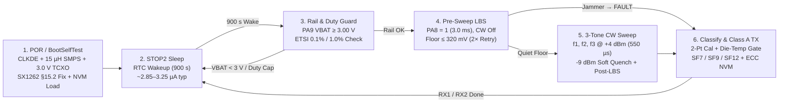
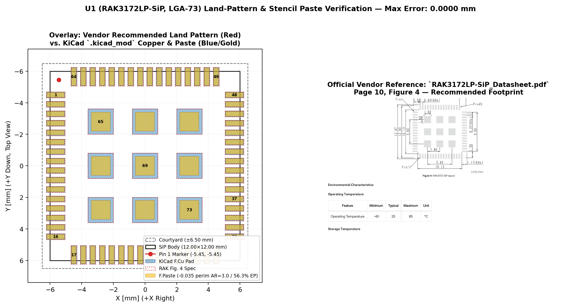

# Freestanding C11 Firmware, `RAK3172LP-SiP` Pin Map & `FPort = 10` Wire Contract (`Rev E.5`)

**Author:** Stephen K. Boachie  
**Hardware Revision:** `Rev E.5` ([`../README.md`](../README.md) · [`../firmware/`](../firmware/))

---

## 1. Bare-Metal Firmware & LoRaWAN 1.0.3 Execution Flow

The target firmware ([`../firmware/`](../firmware/)) is written in freestanding ISO C11 (`-Wall -Wextra -Werror -Wstack-usage=2048 -ffreestanding -nostdlib`), compiling into **15,948 B Flash** and **408 B RAM** on `STM32WLE5JC` without external HAL dependencies, verified by **370 host HIL assertions** (`test_isac_hil.c`) and **1,092 Flash NVM / MAC assertions** (`test_isac_nvm.c`).



### Key Firmware Hardening Measures
- **Silicon Errata & Radio Initialization (`isac_sensing.c`, `isac_lorawan_eu868.c`):** Enables `SUBGHZ_SMPSC0R.CLKDE` (`0x0916 |= 0x40`) with readback verification prior to asserting `PWR_CR5.SMPSEN` (`DS13105` §3.9.1; falls back cleanly to `USE_LDO` on mismatch), configures `SetDIO3AsTCXOCtrl(0x06, 3.0 V)`, applies `SX1262` §15.2 `TxClampConfig` (`0x08D8 |= 0x1E`) PA clamp protection for high-VSWR loads, and sets `0x0889` (BW125 modulation quality) and `0x0736` (IQ polarity) register workarounds.
- **Listen-Before-Sense (`LBS`) & Soft-Ramp CW Quench (`isac_sensing.c`):** Samples `LT5538` with CW disabled before each sweep (two 20 ms `PA8 = 0` backoff retries if ambient ingress exceeds 320 mV $\approx -72\text{ dBm}$) and again after the sweep (650 µs = $6.5\tau_{\text{LPF}}$ discharge) so co-channel LoRa/LTE bursts flag `ISAC_SURFACE_FAULT` rather than corrupting a permittivity reading. Each CW tone ramps down to -9 dBm (40 µs ramp + 50 µs hold) before returning to `STDBY_XOSC` to limit adjacent-channel spectral splatter.
- **Ratiometric ADC Scaling & Temperature-Gated Ice Disambiguation:** Normalizes every 16× oversampled `PA15 / ADC_IN11` reading against the factory-calibrated internal bandgap (`ADC_IN13` `VREFINT` at 3.000 V), eliminating supply-droop error across 3.00–3.30 V (`0 mV` error verified in HIL). Cross-checks 2-point calibrated `(Level, Tilt, Notch)` features against `ADC_IN12` internal die temperature (`ISAC_ICE_MAX_TEMP_DEGC_X10` = +4.0 °C) so thin warm water films above +4 °C are never misclassified as `GLAZE_ICE`.
- **LoRaWAN 1.0.3 EU868 MAC, Crypto & Flash NVM (`isac_lorawan_eu868.c`, `isac_nvm.c`):** Constant-time FIPS-197 AES-128 and RFC 4493 CMAC, OTAA Join with `CFList` parsing, RX1 (+1.0 s) / RX2 (+2.0 s, 869.525 MHz SF12) windows with `SetStopRxTimerOnPreamble(1)`, sticky `RXParamSetupReq` (`0x05`) MAC command handling, §7 3-tier 96-hour Join backoff (< 8.2 s / 24 h in Tier 3), $2^{32}\text{ ms}$ wrap-safe ETSI 0.1% (`g1`) + 1.0% (`EU868`) duty-cycle accounting, and dual-page (`0x0803E800` / `0x0803F000`) CRC-32 NVM with 72-bit Flash `ECCD` `NMI` self-recovery.

---

## 2. `RAK3172LP-SiP` (`U1`, LGA-73) Pin Map & Land-Pattern Verification

Cross-checked automatically by [`../tools/check_bom_cpl.py`](../tools/check_bom_cpl.py) and [`../tools/verify_u1_overlay.py`](../tools/verify_u1_overlay.py) (`0.0000 mm` pad coordinate delta; see [`reports/u1_footprint_verification.md`](reports/u1_footprint_verification.md)) against [`../fab/netlist/ISAC_868_KiCad9.net`](../fab/netlist/ISAC_868_KiCad9.net) and [`../firmware/include/isac_board_pins.h`](../firmware/include/isac_board_pins.h):

| `U1` Pin(s) | SiP / STM32WLE5JC Function | Schematic Net | Firmware Macro / ADC Channel | Connected Subsystem |
| :---: | :--- | :--- | :--- | :--- |
| **`1`** | `PA13 / JTMS-SWDIO` | `/SWDIO` | `ISAC_SIP_PIN_SWDIO` (`PA13`) | `J4.2` (DNP pogo pad) via `D_SWD` (`PESD5V0U2BT,215`); `J4.1` isolated via `R_VAPP` = 1 kΩ + `D_3V3` |
| **`2`** | `PA14 / JTCK-SWCLK` | `/SWCLK` | `ISAC_SIP_PIN_SWCLK` (`PA14`) | `J4.3` (DNP pogo pad) via `D_SWD` (`PESD5V0U2BT,215`) |
| **`3, 4, 55`** | `VDD1 / VBAT / VDD2` | `3V3` | `ISAC_SIP_PIN_VDD1 / VBAT_MCU / VDD2` | Always-on `U3` (`TPS7A0233DBVR`, 24.1 mA peak) + `C_U1A..C` + `D_3V3` |
| *(Internal SiP)* | `PA0 / PA1` (`VC1 / VC2`) + `PB0` (`DIO3`) | *(Internal SiP substrate)* | `ISAC_GPIOA_PIN_RFSW_VC1 / VC2` + `SetDIO3AsTCXOCtrl(0x06, 3.0 V)` | Internal SPDT: IDLE=(0,0), RX=(1,0), TX=(0,1); 3.0 V 32 MHz TCXO (`0x06`) + 32.768 kHz LSE (`LSERDY` fallback to `LSI`) |
| **`6, 7`** | `VREF+ / VDDA` | `/VDDA` | `ISAC_SIP_PIN_VREF_PLUS / VDDA` (`ADC_IN13` `VREFINT`, `ADC_IN12` `TSEN`) | `FB_VDDA` (`BLM15AG121SN1D`) + `C_VDDA1, C_VDDA2, C_VREF` |
| **`8`** | `PA15 / ADC_IN11` | `/DET_ADC` | `ISAC_GPIOA_PIN_DET_ADC` (`15U`), `ADC_IN11` (`SMP1=12.5 cyc`) | Switched from `JTDI` pull-up to analog in `Reset_Handler`; `U2` (`LT5538IDD#TRPBF`) output via `R_LPF` = 1 kΩ, `C_LPF` = 100 nF, `TP4` |
| **`10, 11, 13`** | `VFBSMPS / VDDSMPS / VLXSMPS` | `/VFBSMPS`, `/VDDSMPS`, `/VLXSMPS` | `ISAC_PWR_CR5_SMPSEN` (`0x5800041C`) + `CLKDE` (`0x0916`) | 15 µH wirewound `L_SMPS` (`LQH2MCN150K02L`, $I_{\text{sat}} = 300\text{ mA}$) + `FB_SMPS` = 0 Ω, `C_SMPS1` = 4.7 µF, `C_SMPS2` = 470 nF (`C_SMPS3` = DNP) |
| **`15`** | `PB4 / ADC_IN3` | `/BAT_SENSE` | `ISAC_GPIOB_PIN_BAT_SENSE` (`4U`), `ADC_IN3` | Switched from `NJTRST` pull-up to analog in `Reset_Handler`; `Q2`-gated `R_B1 = R_B2` = 4.7 kΩ (0.1%) + `C_BAT` = 1 nF (150 µs pulse) |
| **`29, 30`** | `PA2 / USART2_TX`, `PA3 / USART2_RX` | `/UART_TX`, `/UART_RX` | `ISAC_GPIOA_PIN_UART2_TX / RX` (Analog High-Z when `ISAC_DEBUG_UART=0`) | `J5.2 / J5.3` (DNP pogo pads) via `D_UART` (`PESD5V0U2BT,215`); `J5.1` isolated by `R_VUART` = DNP |
| **`37`** | `RF_OUT` (50 Ω `RFO_LP` / `RFI`) | `/RF_PA` | `ISAC_SIP_PIN_RF_OUT` (+4 dBm CW / +14 dBm LoRa) | `C_RF` (100 pF) $\to$ CPWG $\to$ Bridge $\to$ Elliptic Pi-Filter (`C_M1`=3.6p, `L_M1`=8.2n $\parallel$ `C_MZ`=0.5p, `C_M2`=4.3p) $\to$ `AE1` |
| **`43`** | `PH3 / BOOT0` | `/BOOT0` | `ISAC_SIP_PIN_BOOT0` | 10 kΩ `R_BOOT` pulldown + `J3` (DNP pogo pads; `J3.2` current-limited via `R_BHI` = 10 kΩ) |
| **`44`** | `NRST` | `/RST` | `ISAC_SIP_PIN_NRST` | `J4.5` (connect-under-reset SWD pogo) + 10 kΩ `R_RST` + 100 nF `C_RST` + `SW1` + `D_RST` (`PESD5V0S1BA,115`) |
| **`50`** | `PA9` (`BAT_MON_EN`) | `/BAT_MON_EN` | `ISAC_SIP_PIN_BAT_MON_EN` (`PA9`, `9U`) | Dedicated battery divider gate: `Q2` (`NX3008CBKS,115` `VBAT_SW`, `R_BG` = 470 kΩ) + 100 kΩ `R_BPD` |
| **`51`** | `PA8` (`DET_EN`) | `/DET_EN` | `ISAC_SIP_PIN_DET_EN` (`PA8`, `8U`) | Dedicated RF detector gate: `VBAT`-fed `Q1` (`TPS22919DCKR` + `C_Q1` = 100 nF $\to$ `3V3_DET`) + 100 kΩ `R_PD` |
| **`53, 54`** | `VDDPA / VDDRF` | `/VDDPA`, `/VDDRF` | `ISAC_SIP_PIN_VDDPA / VDDRF` | Dedicated ferrite beads `FB_PA`, `FB_RF` + 1 µF `C_PAV`, `C_RFV` |
| **`65..73`** | Central 3 × 3 Thermal/RF `GND` | `GND` | Solid `B.Cu` plane (56.3% 1.20 × 1.20 mm windowed paste) | 4 interstitial tented 0.60/0.30 mm vias (0 via-in-pad) |

**Figure 1 — `U1` (`RAK3172LP-SiP`, LGA-73) Land-Pattern, Solder-Mask Dam & Paste Aperture Overlay (`docs/reports/u1_footprint_overlay.png`):**



---

## 3. 10-Byte Big-Endian LoRaWAN `FPort = 10` Wire Contract (`isac_sensing.c`)

Each Class A uplink on `FPort = 10` carries a fixed 10-byte big-endian payload encoding surface state, hardware diagnostics, differential reflectometry features (defined by Equations `(3)`–`(5)` in [`../README.md`](../README.md)), estimated real permittivity, and battery voltage:

| Byte(s) | Field Name | Type & Endianness | Resolution & Physical Encoding |
| :---: | :--- | :---: | :--- |
| **0** | `state_flags` | `uint8` | `[7]=1 (RevE_Frame)`, `[6]=Duty_Throttled`, `[5]=Low_Battery (<3100 mV)`, `[4]=SMPS_DCDC_Active`, `[3:0]=SurfaceState` (`0=DRY_AIR`, `1=OIL`, `2=GLAZE_ICE`, `3=IPA`, `4=LIQUID_WATER`, `15=FAULT`) |
| **1..2** | `tilt_db_x100` | `int16 BE` | 0.01 dB — Band-edge slope $\Delta L_{13} = [V(f_1) - V(f_3)] / K_{\text{det}}$ |
| **3..4** | `level_dbm_x100` | `int16 BE` | 0.01 dBm — Mean coupled reflection power $\bar{L}$ across $f_1, f_2, f_3$ (die-temp compensated) |
| **5..6** | `eps_est_x100` | `uint16 BE` | 0.01 RIU — Piecewise-monotonic estimated real permittivity $\varepsilon_{r,\text{est}}' \times 100$ (`0` on `FAULT`, calibrated for $h_{\text{sup}} \ge 2\text{ mm}$) |
| **7..8** | `vbat_mv` | `uint16 BE` | 1 mV — `PA9`-gated post-`Q3` battery voltage (3000–4200 mV nominal) |
| **9** | `notch_db_x10` | `int8` | 0.1 dB clamped `[-128..+127]` — In-band curvature $\Delta N_2$ |

### Reference ChirpStack / TTN JavaScript Payload Decoder
```javascript
function decodeUplink(input) {
  const b = input.bytes;
  if (input.fPort !== 10 || b.length !== 10) return { errors: ["Invalid FPort 10 frame"] };
  const i16 = (hi, lo) => ((hi << 8) | lo) << 16 >> 16;
  const u16 = (hi, lo) => ((hi << 8) | lo) >>> 0;
  const i8  = (v) => (v << 24) >> 24;
  const states = { 0: "DRY_AIR", 1: "OIL", 2: "GLAZE_ICE", 3: "IPA", 4: "LIQUID_WATER", 15: "FAULT" };
  const code = b[0] & 0x0F;
  return {
    data: {
      surface_state: states[code] || "UNKNOWN",
      smps_active: Boolean(b[0] & 0x10),
      low_battery: Boolean(b[0] & 0x20),
      duty_throttled: Boolean(b[0] & 0x40),
      tilt_db: i16(b[1], b[2]) / 100.0,
      level_dbm: i16(b[3], b[4]) / 100.0,
      eps_est: u16(b[5], b[6]) / 100.0,
      vbat_mv: u16(b[7], b[8]),
      notch_db: i8(b[9]) / 10.0
    }
  };
}
```
