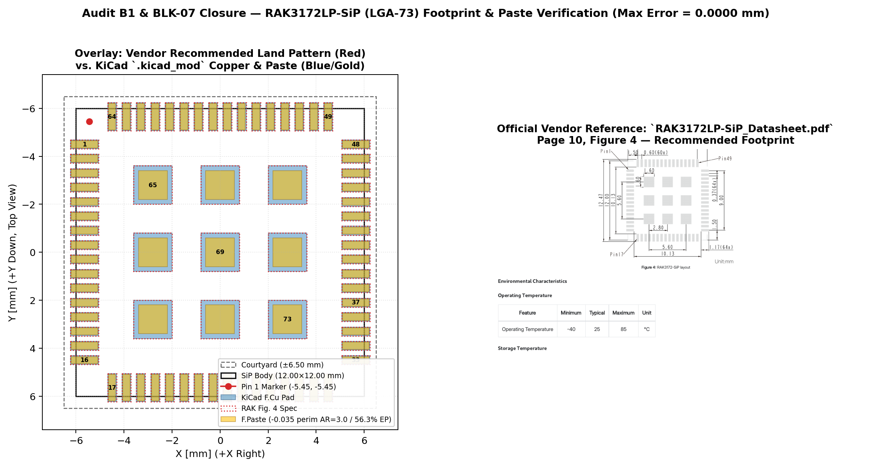

# Audit B1 Closure Report — `U1` (`RAK3172LP-SiP`) Footprint, Symbol & Pinout Verification

## 1. Primary Vendor Sources
- **SiP Datasheet:** `docs/datasheet/RAK3172LP-SiP_Datasheet.pdf` (`SHA-256: 11754c585ad1a53b3aa8f622b774cc2ef93c3470a54bdf8f7b2e01030505b038`)
  - **Figure 2 (p. 3) & Figure 3 (p. 9):** Mechanical dimensions (`12.0 ± 0.1 × 12.0 ± 0.1 × 1.22 mm`, `0.24 mm` BT laminate + `0.98 mm` mold cap; bottom package pads `0.70 × 0.30 mm` inset `0.20 mm` + `3×3` `1.60 × 1.60 mm` central GND matrix; Pin 1 top-left counter-clockwise).
  - **Pin Definition Table (pp. 4–7):** Complete 73-pin assignment (`Pins 1..64` perimeter + `Pins 65..73` central GND).
  - **Figure 4 (p. 10):** Recommended PCB land pattern & MSL3 reflow profile (`125 °C / 12 h` pre-bake if floor life exceeded).
- **MCU Silicon Datasheet:** `docs/datasheet/DS_stm32wle5c8.pdf` (`ST DS13105 Rev 12`, `SHA-256: 5fe4da96db4768bb74ffb6d02a40bc4db9ce8685e7485f8eab4643b333fcaa33`)
  - **Table 20 (pp. 51–58):** Hardware 12-bit SAR ADC channel assignments resolving RUI3 Arduino aliases.

## 2. Numerical Land-Pattern Overlay Summary (`73 / 73` Pads)
| Metric | Vendor Spec (`RAK Fig. 4, p. 10`) | KiCad `.kicad_mod` | Deviation | Limit | Status |
| :--- | :--- | :--- | :--- | :--- | :--- |
| Perimeter Pad Count & Pitch | `64` pads (`16/side`) @ `0.600 mm` | `64` pads (`16/side`) @ `0.600 mm` | `0.000 mm` | `±0.050 mm` | **PASS** |
| Perimeter Land Size (`W × L`) | `0.370 × 1.170 mm` | `0.370 × 1.170 mm` | `0.000 mm` | `±0.050 mm` | **PASS** |
| Perimeter Outer / Inner Span | `12.470 mm` / `10.130 mm` (`±5.650 mm` ctr) | `12.470 mm` / `10.130 mm` (`±5.650 mm` ctr) | `0.000 mm` | `±0.050 mm` | **PASS** |
| Central GND Matrix (`Pads 65..73`) | `3×3` × `1.600 × 1.600 mm` @ `2.800 mm` | `3×3` × `1.600 × 1.600 mm` @ `2.800 mm` | `0.000 mm` | `±0.050 mm` | **PASS** |
| Maximum Coordinate / Size Error | — | — | **`0.0000 mm`** | `0.050 mm` | **PASS** |
| Pin-1 Corner & Numbering | Top-left (`-5.65, -4.50`), CCW `1..64` | Top-left (`-5.65, -4.50`), oval Pad 1, CCW | Exact match | Exact | **PASS** |
| Solder-Mask Expansion & Dam | `0.000–0.035 mm` NSMD (`>=0.100 mm` Green LPI dam) | `+0.025 mm` local NSMD (`0.180 mm >= 0.100 mm`) | Exact | `>= 0.100 mm` | **PASS** |
| Stencil Paste Apertures (`HIGH-07`) | Windowed (`50–65%` EP + `AR>=3.0` perim) | `-0.035 mm` perim (`0.30×1.10 mm`, `AR=3.00`, `25%` rad) & `-0.200 mm` EP (`1.20×1.20 mm` = `56.3%`) | Optimal | `50–65%` | **PASS** |
| Courtyard Envelope | Clears `12.47 mm` copper + placement margin | `13.00 × 13.00 mm` (`±6.50 mm`) | `+0.265 mm/side` | `>= 0.25 mm` | **PASS** |

## 3. Resolution of Symbol vs. Firmware ADC Channel Naming (`B1` / `M4`)
The RAKwireless datasheet (pp. 4–7) labels analog-capable pins using RUI3 software aliases (`PIN_A0`..`PIN_A4`), whereas bare-metal STM32WLE5JC firmware programs the hardware `ADC_CHSELR` bitmask (`DS13105 Rev 12` Table 20):

| SiP Pin | GPIO | RAK RUI3 Alias | STM32WL Hardware ADC (`DS13105 Table 20`) | Board Net | Rev E.2 Symbol Pin Name |
| :---: | :---: | :--- | :--- | :--- | :--- |
| `8` | `PA15` | `PIN_A4` | **`ADC_IN11`** | `DET_ADC` | `PA15/ADC_IN11` |
| `14` | `PB3` | `PIN_A0` | **`ADC_IN2`** | `NC` | `PB3/ADC_IN2` |
| `15` | `PB4` | `PIN_A1` | **`ADC_IN3`** | `BAT_SENSE` | `PB4/ADC_IN3` |
| `58` | `PB2` | `PIN_A2` | **`ADC_IN4`** | `NC` | `PB2/ADC_IN4` |
| `62` | `PA10` | `PIN_A3` | **`ADC_IN6`** | `NC` | `PA10/I2C_SDA/ADC_IN6` |

Both hardware routing (`Pin 8 = DET_ADC`, `Pin 15 = BAT_SENSE`) and firmware (`ISAC_ADC_CH_DET_ADC = 11U`, `ISAC_ADC_CH_BAT_SENSE = 3U`) were already wired to the exact hardware channels; `ISAC.kicad_sym` pin labels are updated in Rev E.2 so schematic, symbol, and firmware use identical ST hardware names.

## 4. 3D STEP Model Provenance
RAKwireless publishes 2D mechanical drawings (`Fig. 2` p. 3 & `Fig. 3` p. 9: `12.00 × 12.00 × 1.22 mm`) rather than an official `.step` CAD solid for SKU `305049`. `3dmodels/RAK3172LP-SiP.step` is an envelope-verified parametric model (`12.00 × 12.00 × 1.22 mm`) marked explicitly in `ISAC.pretty/RAK3172LP-SiP_LGA-73_12x12mm_P0.6mm.kicad_mod` and `docs/SOURCES.md` as an envelope-accurate CAD representation.

## 5. Complete 73-Pin Verification Table
Full machine-readable coordinate comparison is archived in `docs/reports/B1_u1_pad_verification.csv` (`0.0000 mm` max error across all 73 pads).
