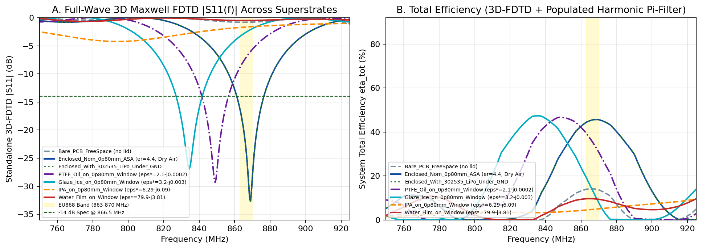
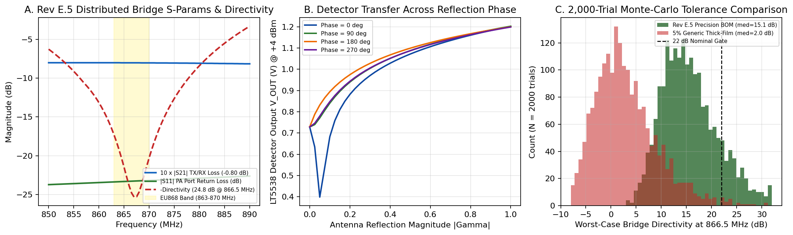
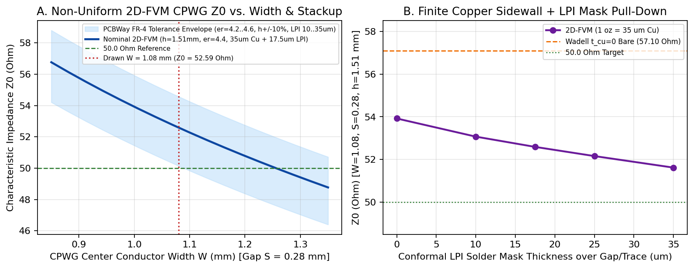

# RF Front-End Synthesis, Full-Wave EM Solvers & Sensing Boundary Conditions (`Rev E.5`)

**Author:** Stephen K. Boachie  
**Hardware Revision:** `Rev E.5` ([`../README.md`](../README.md) · [`ISAC_868MHz_System_Design_and_Operation_Summary.pdf`](ISAC_868MHz_System_Design_and_Operation_Summary.pdf))

---

## 1. Multi-Solver Electromagnetic & Circuit Verification Architecture

Two complementary electromagnetic modeling environments are maintained in this repository—open-source numerical solvers in [`../rf/`](../rf/) and a parameterized 3D SIMULIA CST Studio Suite package in [`../cst_studio/`](../cst_studio/)—all driven directly from the KiCad `Rev E.5` copper geometry (`AuxOrigin = (103.500, 120.000) mm`):

1. **Interface-Graded 2D Finite-Volume (`2D-FVM`) CPWG Solver ([`../rf/cpwg_2dfvm_solver.py`](../rf/cpwg_2dfvm_solver.py)):** Solves Laplace's equation $\nabla \cdot (\varepsilon_r(x,y)\nabla V) = 0$ across the 1.51 mm FR-4 core ($\varepsilon_r = 4.4 \pm 0.2$), 35 µm (1 oz) copper thickness, and conformal Green LPI solder mask ($\varepsilon_r = 3.4$). For a top trace width $W = 1.08\text{ mm}$ and coplanar gap $S = 0.28\text{ mm}$ over unbroken `B.Cu`, the solver predicts $Z_0 = 51.90\ \Omega$ nominal (51.2–57.1 Ω manufacturing tolerance envelope, return loss $\ge 26.8\text{ dB}$, cross-checked within 1% of Wadell / Ghione–Naldi conformal mapping). Keeping the longest CPWG segment to 11.18 mm ($0.056\lambda_g$ at 868 MHz) desensitizes system matching to 2-layer FR-4 permittivity spread.
2. **3D Non-Uniform Yee-Grid Maxwell FDTD Engine ([`../rf/fdtd_3d_ant.c`](../rf/fdtd_3d_ant.c) + [`../rf/ifa_enclosure_mom.py`](../rf/ifa_enclosure_mom.py)):** C99/OpenMP 3D FDTD solver importing the exact [`IFA_868MHz_ISAC_40x20mm.kicad_mod`](../ISAC.pretty/IFA_868MHz_ISAC_40x20mm.kicad_mod) polygon, 50 × 40 mm counterpoise, IPC-4552 ENIG (`NiP/Au`) surface resistance ($R_s = 23.74\text{ m}\Omega/\square$), 25 µm 3M 467MP transfer adhesive, 0.80 mm self-draining ASA/PETG window, internal LiPo/Li-SOCl2 cell, and 2.0 mm dielectric superstrates. The resulting 1-port impedance $Z_{\text{ant}}(f)$ is cascaded with the 3rd-order elliptic low-pass Pi-filter (`C_M1` = 3.6 pF `GJM1555C1H3R6WB01D`, `L_M1` = 8.2 nH `LQW15AN8N2G00D` $\parallel$ `C_MZ` = 0.5 pF `GJM1555C1HR50WB01D`, `C_M2` = 4.3 pF `GJM1555C1H4R3WB01D`), suppressing $2f_0$ (1.733 GHz) by $\ge 37.2\text{ dB}$ and $3f_0$ (2.600 GHz) by $\ge 60.1\text{ dB}$ across dry and water-loaded VSWR states.
3. **SIMULIA CST Studio Suite 3D FIT & Curved-Element FEM Package ([`../cst_studio/README.md`](../cst_studio/README.md)):** Independent 3D full-wave model using conformal Perfect Boundary Approximation (`PBA`) hexahedral subcells (`FIT`, 0.70–3.00 GHz, `-45 dB` steady-state convergence), 2nd-order curved tetrahedral adaptive `FEM` at 866.5 MHz, causal 1st-order Debye dispersion for polar fluids, and CST Design Studio co-simulation macros.
4. **Distributed Microstrip Bridge & 2,000-Trial Monte-Carlo ([`../rf/bridge_sparam_mc.py`](../rf/bridge_sparam_mc.py) & [`../rf/bridge_loss.py`](../rf/bridge_loss.py)):** Models the inline `R1` = 8.2 Ω (`RT0402BRD078R2L`, 0.1%) sense resistor, 0.1% Susumu `RG1005P` reference network (`R2` = 681 Ω, `R3` = 3.57 kΩ, `R_TERM` = 56 Ω), ±2% Murata `LQW15AN` inductors (`L_Q` = 27 nH, `L_S` = 30 nH), ±0.05 pF `GJM1555C1H` capacitors (`C_S = C_S2` = 1.0 pF), dual-layer 2.20 × 2.20 mm `/BR_S` ground relief ($C_{\text{par}} = 0.1305\text{ pF} < 0.15\text{ pF}$), and Analog Devices `LT5538IDD#TRPBF` input impedance ($Z_{\text{IN+}} = 291.65\ \Omega \parallel 1.194\text{ pF}$ at 866.5 MHz). Across 2,000 3$\sigma$ passive tolerance trials under 2-point calibration (`h_sup = 2.0 mm`), the bridge maintains -0.802 dB main-path insertion loss, 24.81 dB nominal 50 Ω directivity, 17.60 dB 1st-percentile (`P01`) Air-to-Ice contrast (100% yield), and 99.72% Water-vs-IPA separation yield (`P01` margin 0.65 dB $\ge$ 0.50 dB).

---

## 2. Full-Wave & Circuit Simulation Plots

**Figure 1 — Standalone `AE1` 3D-FDTD Return Loss $\lvert\Gamma_{\text{ant}}(f)\rvert$ and Filter-Cascaded Total Efficiency $\eta_{\text{tot}}(f)$ (`rf/results/ifa_enclosure_mom.png`):**

> **Reference-Plane Distinction:** Panel A plots **standalone** antenna reflection $\lvert\Gamma_{\text{ant}}(f)\rvert$ directly at `AE1` Pad 1 (`/ANT_FEED`), where Enclosed Dry Air reaches -32.69 dB at $f_0 = 869.0\text{ MHz}$ and -23.69 dB at $f_2 = 866.5\text{ MHz}$. Panel B and the 3-tone reflectometer benchmarks in [`../README.md`](../README.md) evaluate the **Pi-filter-cascaded** input reflection $\lvert\Gamma_{\text{in}}(f)\rvert$ at `/BR_Q`, which equals -20.83 dB at $f_2 = 866.5\text{ MHz}$.

**Figure 2 — Asymmetric Return-Loss Bridge S-Parameters & 2,000-Trial Tolerance Monte-Carlo (`rf/results/bridge_sparam_mc.png`):**

**Figure 3 — 2D-FVM 51.90 Ω CPWG Cross-Section & Conformal Solder-Mask Pull-Down (`rf/results/cpwg_2dfvm_cross_section.png`):**

---

## 3. Physical Sensing Limitations, Boundary Conditions & `Rev F.0` Roadmap

For academic transparency and field-deployment planning ahead of scaling beyond the `Rev E.5` pilot batch, six physical and architectural boundary conditions apply:

1. **Film-Thickness vs. Permittivity Degeneracy ($\varepsilon_r' \times h_{\text{film}}$):** Planar interdigital sensors probe an exponentially weighted evanescent region of characteristic $1/e$ decay depth $\delta_E \approx (w + g)/\pi \approx 0.80\text{ mm}$ above the radome. While a continuous superstrate thicker than $2\delta_E$ ($\approx 1.6\text{–}2.0\text{ mm}$) approaches the half-space asymptote, a sub-millimeter condensation film ($h_{\text{sup}} < 0.3\text{ mm}$) or sparse droplets only partially load the fringing field and can traverse intermediate $(\Delta L_{13}, \bar{L})$ loci similar to thicker oil or ice layers. Field analytics should pair `FPort = 10` features with thermal gating ($\le +4.0\ ^\circ\text{C}$ for `GLAZE_ICE`) and multi-frame temporal persistence.
2. **Narrowband EU868 Skirt Compression (6.4 MHz Probing Span):** Regulatory confinement to 863.1–869.5 MHz (0.74% fractional bandwidth) means that once a high-permittivity medium ($\varepsilon_r' \ge 6$) pulls $f_0$ below 800 MHz, all three CW tones sample the high-reflection upper skirt ($\lvert\Gamma_{\text{in}}\rvert \approx -0.5\text{ to }-2.2\text{ dB}$). Separating Water from lossy polar fluids such as IPA relies on ~0.23 dB of `Tilt` and ~1.4 dB of calibrated `Level`—practical in controlled conditions after 2-point calibration, though sensitive to partial wetting outdoors.
3. **Electrically Small Counterpoise (50 × 40 mm = $0.145\lambda_0$) & Mounting Surface Coupling:** On a sub-wavelength ground plane, `B.Cu` chassis currents radiate a substantial fraction of total power. Bolting the housing directly onto structural steel (bridge girders, wind-turbine nacelles) vs. concrete or timber alters ground-plane image currents and input impedance. Either space the enclosure $\ge 10\text{–}15\text{ mm}$ off metallic surfaces on a dielectric bracket or execute the Point-1 Dry-Air tare (`--cal-dry-mv`) on the target mounting substrate.
4. **2-Layer FR-4 Tolerance ($\varepsilon_r = 4.4 \pm 0.2$), CPWG Etch Factor & `C_MZ` Pad Parasitics:** Uncontrolled 2-layer 1.60 mm FR-4 shifts unloaded $f_0$ by roughly ±8–12 MHz across laminate lots, the 0.28 mm CPWG gap is sensitive to 1 oz copper etch tolerance, and 0402 pad fringing (~0.1 pF across `L_M1`) can pull the `C_MZ = 0.5 pF` $2f_0$ notch slightly low (verified in pilot step `O-02` of [`OPEN_ITEMS.md`](OPEN_ITEMS.md)). Migrating to a controlled-impedance 4-layer stackup with mitered $45^\circ$ antenna bends is planned for `Rev F.0`.
5. **Broadband `LT5538` Detector Selectivity (40 MHz–3.8 GHz):** While Listen-Before-Sense (`LBS`) pre/post blanking (documented in [`firmware_and_pinmap.md`](firmware_and_pinmap.md)) rejects intermittent LoRa/LTE bursts, continuous strong out-of-band emitters near an industrial site will trigger repeated `FAULT` deferrals. Adding an 868 MHz SAW bandpass pre-filter ahead of `U2` Pin 2 (`IN+`) is planned for `Rev F.0`.
6. **Discrete Bridge Parasitics & Die-Temperature Thermal Lag:** Holding `/BR_S` parasitic capacitance below 0.15 pF requires tight dual-layer copper relief, and reading `STM32WLE5JC` internal die temperature (`ADC_IN12`) introduces thermal lag across the internal air cavity during rapid radiative frost events near 0 °C. Evaluating a monolithic 0603/0805 LTCC directional coupler and an inner-radome NTC thermistor is scheduled for `Rev F.0`.
